# MUSP v0.7 — UDP 多协议模拟示例协议及交互流程（讨论稿）

> **性质**：专门为了验证“多系统、多协议、设备管理、动态字段、可编排交互、请求等待匹配、认证变量传递”而设计的**自定义样例协议**，不是任何行业或国家标准，不代表用户已有真实协议。
>
> **状态**：v0.8 业务讨论稿。字段类型、尺寸、信令码、超时策略、校验方式都可以由后续真实业务场景修订。此版本优先追求前后逻辑自洽、可编码、可解析、可复现。

## v0.8 变更说明：配置类 8B 通用段与全信令结构化解析

- 新增**可选的配置类通用段 `configCommon8`**，物理位置为公共协议头（包括已经启用的认证扩展）之后、配置类信令专用业务体之前。通用段计入 `bodyLength`，**不计入 `headerLength`**。
- 本稿示例以 `0x21 CONFIG_SET` 启用该段，以 `0x22 CONFIG_RESULT` 关闭该段；是否启用是**每条信令的模板属性**，不是按 `0x21/0x22` 码值写死的。关闭时兼容 v0.7 的 91B 配置请求及 31B 配置响应。
- 8B 中仅确认**高 1 bit 与低 1 bit 的控制标志位置**：Bit7 = 原子性标识，Bit0 = 结束标识。其余 6 位保留；其余 7 字节的名称和用途均为**建议方案，待真实协议修订**。
- 原子性、结束标志**不直接构成成功应答**：最终生效仍要看请求/响应关联、逐条结果 `AA`、配置批次完成和真实对端是否支持原子提交。
- 协议字段表沿用 `序号｜字段名称｜字段长度（字节）｜字段类型｜说明`，不新增偏移列，主字段类型仍用 `HEX`。**只有“报文解析结果视图”展示实际起止字节位置、Bit 位、十六进制、十进制和中文含义**。
- 增加一份带认证扩展、8B 通用段和 5×10B 动态配置数组的 **99B 完整报文实例**，已重算长度和 CRC。
- 前版其他注册、语音/视频、寻呼、RX/TX 带宽、通信结束、离线和设备三态规则保持不变。

## v0.7 变更说明：设备配置响应采用逐条结果数组

- **不调整请求报文** `CONFIG_SET (0x21)`：仍支持配置模式 `01`（每条是一台设备）或 `02`（同一设备下的多组参数），请求条目和长度字段保持不变。
- **修改响应报文** `CONFIG_RESULT (0x22)`：业务体简化为 `itemCount (1B) + results[itemCount] (每项1B)`。每个响应结果与请求中的配置条目**按原始顺序逐项对应**。
- **已确认结果码**：`AA` 表示该条目配置成功；其他返回码尚未定义，不能擅自指定 `00` 或其他 HEX 数值代表具体失败原因。
- 示例请求包含 `05` 条配置且全部成功，响应业务体 `05 AA AA AA AA AA`，长度 `06`（6 字节），不再包含总结果码、配置生效版本、成功/失败条目数或失败编号数组。
- 接收 `0x22` 时仍以公共头中的信令码、事务序号、会话和源/目标设备地址关联对应 `0x21` 请求；校验响应数量和业务体长度，按条目索引应用成功或待确认状态。
- 全量替换若存在非 `AA` 项，样例默认不得全量提交；增量模式允许依协议配置对 `AA` 项逐条生效。未收到应答不能假定配置失败，也不能假定配置成功。

## v0.6 变更说明：设备三态与完整通信结束闭环

- **设备管理展示及协议状态字段只允许三态**：`00=OFFLINE 离线`、`01=ONLINE 在线`、`02=COMMUNICATING 通信`。不引入 OFFLINING、SUSPECT、REGISTERING 等第四种设备状态；注册中、清理中、超时检测是独立的流程运行状态。
- 新建设备（手动或配置信令创建）默认 OFFLINE；配置更新现有设备不自动改变其状态；注册完成后 ONLINE；至少一条本机已建立通信保持 COMMUNICATING；结束最后一条通信后恢复 ONLINE；主动离线或按心跳门限判定掉线时直接 OFFLINE。
- 细化 `0x73` 设备 A/B 任一方主动结束、控制系统主动结束、`0x7D` 主动离线、心跳失联引发的结束子流程。不同触发方式复用 `0x78` 终止通知、`0x76/0x77` 按设备和方向逐项撤销、`0x7A` 结果汇总。
- `0x7D.offlineMode=01` **只规定是否保留清理通信窗口**，不能新建 OFFLINING 设备状态；一经主动离线有效触发，设备状态即 OFFLINE，但可以继续处理限定的清理信令。
- 区分业务已停止与资源核销完成，未确认资源处于 UNKNOWN，不恢复可分配容量；再注册不能复用旧通话会话和迟到事务。

## v0.5 变更说明：设备离线

- 新增一条**设备主动离线通知** `0x7D`（DEVICE_OFFLINE_NOTIFY），由设备向控制系统发出。该信令默认**不要求应答**，不得误称为已有的请求—响应事务；需要可靠确认时应通过具体协议扩展，不在 v0.5 凭空增加第二条离线信令。
- （v0.6 已修正）设备展示状态仅为 `OFFLINE / ONLINE / COMMUNICATING`；离线发起及心跳失联产生的清理、观察等阶段只作为流程运行状态，不加入设备状态枚举。
- 在线设备可以选择立即断开清理通道或保留临时清理窗口，**两种情况下设备状态均直接转 OFFLINE**。异常掉电或网络中断不会发送 `0x7D`，由心跳/收包规则达到离线判定门限后转 OFFLINE。
- 离线会触发该设备所参与的所有通话终止或异常结束子流程，并通知仍在线的参与方；对离线设备无法确认释放的 RX/TX 资源保留 `UNKNOWN`，不能直接回收到可分配资源池。
- 补充完整离线时序、发送限制、重注册规则和针对多通话/并发/重复报文的测试用例。保留 v0.4 已有 `0x73`—`0x7C` 通话与资源释放信令及 23B 公共头不变。

## v0.4 变更说明

- **保留 v0.3 全部已确定的公共头和业务结构**：信令码 1B、会话 ID 2B、设备协议地址 3B、基础公共头 23B、申请带宽和资源分配分离。既有十六进制报文示例不受新信令影响。
- **通话启动方式可配置**：本机资源配置成功即允许启动（LOCAL_READY），或控制系统统一发送 `0x75` 就绪通知（CONTROL_NOTIFY）。
- **完善通信结束闭环**：设备/控制端发起结束、通知其他参与方停止业务、按设备和 RX/TX 方向逐项撤销资源、等待释放确认、判断是否真正回收；完整结束与受理释放分别定义。
- 新增 `0x75`—`0x7C` 信令（均为 1B 信令码，含通知、撤销和取消申请），用于验证正常结束、控制端强制结束、异常掉线、通话尚未建立的取消以及未知资源状态。
- 区分通话的**业务终止**和**资源释放确认**；响应超时不得假定已经释放带宽。

## v0.3 变更说明

- `msgCode` 固定 **1 字节**、`sessionId` 固定 **2 字节**、`srcAddr/dstAddr/targetDeviceAddr/deviceAddr` 统一 **3 字节**。设备 A 地址 `00 00 3B` 只是示例值，不代表地址长度为 1 字节。
- 基础头长度统一修正为 **23 字节（HEX `17`）**，认证扩展 6 字节时头长 **29 字节（HEX `1D`）**。更新动态配置、报文总长和全部示例 CRC。
- 保留原注册、认证、设备配置、心跳、状态上报与业务信令；补充 **A→B 视频通话**及 **A→控制系统语音通话**两套交互流程。
- **申请带宽放在通话申请业务体里；分配资源由两条独立配置指令 `0x70`（接收）与 `0x71`（发送）下发**，设备分别返回 `0x72` 进行确认。
- 呼叫许可与资源就绪为不同状态。通话 ID `callId` 与设备注册会话 `sessionId` 分开；TX/RX 各自跟踪确认、超时、重复报文及回收。
- 修正 v0.2 中一些残留的两字节信令码、旧长度及旧 HEX 示例。新信令字段、带宽单位、频点仅作**示例协议草案**，待真实业务确认。

## 1. 目标与边界

1. 参与系统：A（设备系统），B（对端控制系统），也允许场景中扩展 C 等系统。
2. A 系统可模拟设备地址 `00 00 3B`；B 系统控制中心逻辑地址 `00 00 01`。协议逻辑地址不等于 UDP IP:port。
3. 可以由平台模拟 A、B 任意一侧或同时模拟双方；另一侧可以是实际外部设备/软件。
4. 一套系统可以关联多种协议；协议库是独立对象。**MUSP 的公共头仅属于 MUSP 协议**；其他系统协议可以有完全不同的头部、字段、信令码、字节序、校验方式。
5. 支持设备手动创建和依据配置信令自动创建/更新；配置数组既可以代表多设备，也可以代表单设备多组参数。
6. 流程编排与报文定义解耦：绑定“信令模板 ID”，而不是将字段或具体 HEX 写死在流程节点中。
7. 新增无人机 A↔无人机 B 视频呼叫、无人机 A↔控制中心单端语音对话。申请报文携带带宽诉求，控制中心分别用 RX/TX 资源配置信令下发实际带宽。

## 2. 协议字段表示和字节序

本版协议文档的**所有报文字段表**统一使用以下列顺序：**序号｜字段名称｜字段长度（字节）｜字段类型｜说明**。不再列出“偏移”或“业务体偏移”。报文中的实际字节全部以 **HEX（十六进制）** 表示，示例采用空格分隔的连续十六进制字节，例如 `AA 55`、`00 01`、`00 00 00 3B`。信令编号在正文中写作 `0x01`；报文字节示例写作 `01`。设备地址字段均为 **3 字节**，如 `00 00 3B`。

- **字段类型**：主表统一填写 `HEX`，不使用 `U8/U16/U32` 作为展示类型。
- **字段长度**：以 Byte 为单位，例如 `1`、`2`、`4`、`N`、`5×10`，这是字节数而非数值本身；计算式在文字中可以采用十进制说明。
- **字段数值**：任何写入报文的值都使用十六进制表示，例如 1 字节计数 5 写作 `05`，1 字节长度 10 写作 `0A`，2 字节配置版本 1 写作 `00 01`。
- **解析语义**：HEX 是展示/传输表示，并不替代内部编码属性。协议配置仍需知道字段是否按无符号整数、有符号补码、位域、字节数组等方式解释，以便长度计算、比较和运算。
- **字节序**：MUSP v0.3 多字节数值统一采用**大端序**；其他协议可以自行指定大端、小端或混合规则。
- **可变长度**：由前序计数、长度字段或结构表达式决定，配置引擎负责验证字节总长。

MUSP 消息由一个 UDP 数据报承载，不假设 UDP 有序或可靠。CRC 只用于检测意外数据损坏，**不代表加密或安全认证**。

## 3. 公共报文头

基本布局：`基础头（23 字节） + 可选扩展头（0~N 字节） + 业务体（M 字节） + CRC16（2 字节）`。

| 序号 | 字段名称 | 字段长度（字节） | 字段类型 | 说明 |
|---:|---|---:|---|---|
| 1 | 同步头（magic） | 2 | HEX | 固定 `AA 55` |
| 2 | 协议版本（version） | 1 | HEX | `01` |
| 3 | 头部长度（headerLength） | 1 | HEX | 无扩展头时为 `17`（23 字节） |
| 4 | 报文总长度（totalLength） | 2 | HEX | 自动计算：头部长度 + 业务体长度 + 2 字节 CRC |
| 5 | 信令码（msgCode） | 1 | HEX | 例如注册请求 `01` |
| 6 | 源设备地址（srcAddr） | 3 | HEX | 设备 A 示例 `00 00 3B` |
| 7 | 目标设备地址（dstAddr） | 3 | HEX | 控制端 B 示例 `00 00 01` |
| 8 | 标志位（flags） | 1 | HEX | `01` 表示有认证扩展；`02` 表示响应；可组合为 `03` |
| 9 | 保留字段（reserved） | 1 | HEX | 固定 `00` |
| 10 | 事务序号（transactionId） | 4 | HEX | 例如 `00 00 00 01`，应答必须回填请求值 |
| 11 | 会话 ID（sessionId） | 2 | HEX | 未建立会话时 `00 00`；示例会话 `12 34` |
| 12 | 业务体长度（bodyLength） | 2 | HEX | 仅业务体字节数，不含头部与 CRC |
| 13 | 可选扩展头（headerExtensions） | 可变 | HEX | 由头部长度决定，支持认证 TLV |
| 14 | 业务数据体（body） | 可变 | HEX | 按信令码选择对应业务体定义 |
| 15 | CRC16 | 2 | HEX | CRC-16/CCITT-FALSE，大端存储 |

前 12 个字段构成 **23 字节基础公共头**。第 13~15 项依次跟随，不计入基础头 23 字节。

当 `flags.bit0` 为 1，必须包含且只能包含一个认证扩展 `A1 [长度:1字节] [Token:变长]`。例如 4 字节测试 Token：`DE AD BE EF`，总扩展长度 6 字节。`flags.bit1` 表示请求响应类型。无扩展头时 `headerLength=17`；携带上述扩展时 `headerLength=1D`。

本稿 CRC-16/CCITT-FALSE 参数：`poly=0x1021，init=0xFFFF，refin=false，refout=false，xorout=0x0000`。CRC 覆盖同步头至业务体末尾，**不包含最后两字节 CRC 本身**。解析后须验证实际 UDP 载荷长度与头部、业务体、CRC 长度一致。


### 3.1 配置类通用段与公共头的边界（v0.8）

- 基础公共头仍然是 23B。认证扩展 TLV（若有）仍位于公共头扩展内，其长度由 `headerLength` 决定。
- `configCommon8` **不是基础公共头的一部分**，即使它在字节流里紧接公共协议头，也属于业务体起始位置；它本身占 8 字节。
- 对启用 `configCommon8` 的 `0x21`：`bodyLength = 8 + 10 + itemCount × itemSize`；无认证扩展的 `totalLength = 23 + bodyLength + 2`。如果保留 6B 认证扩展则 `totalLength = 23 + 6 + bodyLength + 2`。
- `configCommon8` 的实际字段定义为**协议模板**，不是 UDP 引擎写死的特殊结构；其他系统可以用 4B、12B，甚至不设置这种通用段。

## 4. 信令码字典与方向

| 序号 | 信令码 | 信令名称 | 来源→目标（示例） | 期望响应信令码 | 说明 |
|---:|---|---|---|---|---|
| 1 | `0x01` | REGISTER_REQ 开机注册请求 | A→B | `0x02` | 建立注册事务 |
| 2 | `0x02` | REGISTER_LICENSE 注册许可响应 | B→A | 无 | 回填请求事务号 |
| 3 | `0x03` | REGISTER_CONFIRM 注册确认请求 | A→B | `0x04` | 新的请求—响应事务 |
| 4 | `0x04` | REGISTER_COMPLETE 注册完成响应 | B→A | 无 | 回填注册确认事务号 |
| 5 | `0x11` | AUTH_ISSUE 认证信息下发 | B→A | `0x12` | 可插入注册过程中，独立事务 |
| 6 | `0x12` | AUTH_ACK 认证接收确认 | A→B | 无 | 回填认证下发事务号 |
| 7 | `0x21` | CONFIG_SET 设备配置请求 | B→A | `0x22` | 两种动态条目映射模式 |
| 8 | `0x22` | CONFIG_RESULT 设备配置响应 | A→B | 无 | 1B条目数 + 每条1B结果，`AA`表示成功 |
| 9 | `0x31` | HEARTBEAT_REQ 心跳请求 | A→B | `0x32` | 运行期周期心跳 |
| 10 | `0x32` | HEARTBEAT_RSP 心跳响应 | B→A | 无 | 心跳确认 |
| 11 | `0x41` | STATUS_REPORT 设备状态上报 | A→B | 无 | 单向事件，可携带动态数组 |
| 12 | `0x51` | BUSINESS_CMD 业务控制命令 | B→A | `0x52` | 可按认证策略注入 Token |
| 13 | `0x52` | BUSINESS_RESULT 业务控制响应 | A→B | 无 | 回填业务命令事务号 |
| 14 | `0x60` | VIDEO_CALL_REQ 视频通话申请 | 无人机A→控制系统 | `0x61` | 携带被叫地址与申请的收、发带宽 |
| 15 | `0x61` | VIDEO_CALL_RSP 视频通话响应 | 控制系统→无人机A | 无 | 返回寻呼结果与通话标识；仅代表呼叫获准，不等于资源就绪 |
| 16 | `0x62` | PAGING_REQ 寻呼请求 | 控制系统→无人机B | `0x63` | 寻呼中继；携带主叫与带宽诉求 |
| 17 | `0x63` | PAGING_RSP 寻呼应答 | 无人机B→控制系统 | 无 | 接受 / 拒绝 / 忙 |
| 18 | `0x64` | CALL_NOTIFY 通话通知 | 控制系统→无人机B（可扩展到A） | 无 | 通知呼叫结果及通话标识 |
| 19 | `0x65` | VOICE_CALL_REQ 语音对话申请 | 无人机A→控制系统 | `0x66` | 单端发起，带宽由申请填写 |
| 20 | `0x66` | VOICE_CALL_RSP 语音对话响应 | 控制系统→无人机A | 无 | 控制系统许可或拒绝 |
| 21 | `0x70` | RX_RESOURCE_CFG 接收资源配置 | 控制系统→对应无人机 | `0x72` | 单独下发接收方向的带宽、频点/时隙 |
| 22 | `0x71` | TX_RESOURCE_CFG 发送资源配置 | 控制系统→对应无人机 | `0x72` | 单独下发发送方向的带宽、频点/时隙 |
| 23 | `0x72` | RESOURCE_CFG_ACK 资源配置确认 | 无人机→控制系统 | 无 | 回填原资源配置事务号与方向，分别确认 |
| 24 | `0x73` | CALL_RELEASE_REQ 通话释放请求 | 任一参与终端→控制系统 | `0x74` | 释放指定通话及已分配资源 |
| 25 | `0x74` | CALL_RELEASE_RSP 通话释放响应 | 控制系统→请求端 | 无 | 返回释放结果 |
| 26 | `0x75` | CALL_READY_NOTIFY 通话就绪通知 | 控制系统→参与设备 | 可选 `0x79` | 控制系统统一启动模式下发送；本机就绪模式可不使用 |
| 27 | `0x76` | RESOURCE_RELEASE_CFG 资源撤销配置 | 控制系统→参与设备 | `0x77` | 对单个 RX 或 TX 资源单独撤销 |
| 28 | `0x77` | RESOURCE_RELEASE_ACK 资源撤销确认 | 参与设备→控制系统 | 无 | 回填事务号，确认该条资源是否真正释放 |
| 29 | `0x78` | CALL_END_NOTIFY 通话终止通知 | 控制系统→参与设备 | 可选 `0x79` | 通知停止该 callId 对应的音视频业务，先于资源回收 |
| 30 | `0x79` | CALL_EVENT_ACK 通话事件确认 | 参与设备→控制系统 | 无 | 对 `0x75` 或 `0x78` 分别应答，由 eventType 区分 |
| 31 | `0x7A` | CALL_END_RESULT 通话结束结果通知 | 控制系统→参与设备 | 无 | 报告资源已释放、部分完成或状态未知 |
| 32 | `0x7B` | CALL_CANCEL_REQ 未建成呼叫取消 | 主叫设备→控制系统 | `0x7C` | 原申请尚未分配 callId 时按原申请事务号取消 |
| 33 | `0x7C` | CALL_CANCEL_RSP 呼叫取消响应 | 控制系统→主叫设备 | 无 | 返回取消是否受理，不能等同全部资源清理完毕 |
| 34 | `0x7D` | DEVICE_OFFLINE_NOTIFY 设备离线通知 | 无人机→控制系统 | 无 | 设备主动报告离线或计划离线；控制系统按设备找到关联通话并执行终止/回收流程 |

**可配置规则**：协议可能存在一对多应答、无应答、主动异步下发、同信令码请求/响应等情况。上述信令码只属于 MUSP 示例协议，实际匹配关系应由每条信令的交互流程显式配置，不由码值顺序推导。

## 5. 注册和认证相关信令业务体

### 5.1 REGISTER_REQ（0x01）——10 字节

| 序号 | 字段名称 | 字段长度（字节） | 字段类型 | 说明 |
|---:|---|---:|---|---|
| 1 | 设备类型（deviceType） | 1 | HEX | 例如 `01` |
| 2 | 设备业务编号（deviceNumericId） | 4 | HEX | 例如 `00 00 00 3B` |
| 3 | 启动原因（bootReason） | 1 | HEX | `01` 正常上电 |
| 4 | 能力标志（capabilityFlags） | 2 | HEX | 例如 `00 03` |
| 5 | 配置版本（configVersion） | 2 | HEX | 例如 `00 01` |

注册请求的 `sessionId` 为 `00 00`，`flags=00`。源逻辑地址根据当前设备的协议身份自动绑定，按 3 字节大端编码。

### 5.2 REGISTER_LICENSE（0x02）——7 字节

| 序号 | 字段名称 | 字段长度（字节） | 字段类型 | 说明 |
|---:|---|---:|---|---|
| 1 | 许可结果（resultCode） | 1 | HEX | `00` 允许、`01` 拒绝、`02` 稍后重试 |
| 2 | 许可有效时间（validSeconds） | 4 | HEX | `00 00 0E 10` = 3600 秒 |
| 3 | 认证模式（authMode） | 1 | HEX | `00` 无需认证、`01` 单独下发认证信息 |
| 4 | 保留字段（reserved） | 1 | HEX | 固定 `00` |

许可成功时，控制系统在**响应公共头**的 `sessionId` 中给出新会话（例如 `12 34`）并回填原注册请求的事务号。许可响应成功并不意味着注册流程已经完成。

### 5.3 AUTH_ISSUE（0x11）——5+N 字节

| 序号 | 字段名称 | 字段长度（字节） | 字段类型 | 说明 |
|---:|---|---:|---|---|
| 1 | Token 有效时间（tokenValidSeconds） | 4 | HEX | `00 00 07 08` = 1800 秒 |
| 2 | Token 长度（tokenLength） | 1 | HEX | 例如 `04`，表示 4 字节 |
| 3 | Token 数据（token） | N | HEX | 例如 `DE AD BE EF`；N 由 tokenLength 决定 |

由控制端 B 主动发起新的事务，生成新的 `transactionId`；与当前已建立的会话 `sessionId` 关联。它可以在注册主流程等待认证就绪时到达并触发认证子流程。

### 5.4 AUTH_ACK（0x12）——1 字节

| 序号 | 字段名称 | 字段长度（字节） | 字段类型 | 说明 |
|---:|---|---:|---|---|
| 1 | 认证接收结果（resultCode） | 1 | HEX | `00` 接收成功、`01` 拒绝 |

### 5.5 REGISTER_CONFIRM（0x03）——5 字节

| 序号 | 字段名称 | 字段长度（字节） | 字段类型 | 说明 |
|---:|---|---:|---|---|
| 1 | 设备业务编号（deviceNumericId） | 4 | HEX | 例如 `00 00 00 3B` |
| 2 | 确认结果（confirmResult） | 1 | HEX | `00` 确认许可 |

注册确认需要使用**新的事务序号**。当许可 `authMode=01` 时，必须等待认证信息接收并成功确认后才能进入本步骤；需要认证时按策略将 Token 编码到公共头的扩展 TLV 中。

### 5.6 REGISTER_COMPLETE（0x04）——3 字节

| 序号 | 字段名称 | 字段长度（字节） | 字段类型 | 说明 |
|---:|---|---:|---|---|
| 1 | 完成结果（resultCode） | 1 | HEX | `00` 完成，其他值表示失败 |
| 2 | 已确认能力标志（acceptedCapabilities） | 2 | HEX | 例如 `00 03` |

仅在收到合法的注册完成响应且结果为 `00` 后，流程的注册结果为 `REGISTERED`，并将设备状态设为 `ONLINE (01)`。`REGISTERED` 不是第四种设备状态。

## 6. 动态设备配置（0x21 / 0x22）

### 6.0 配置类通用段（可选，8 字节，v0.8 候选方案）

它位于**公共头及可选认证扩展之后，专用配置信令数据之前**。注意：下面的批次编号、分段编号和保留区属于设计提案，尚不是用户实际协议已经确认的字段。

| 序号 | 字段名称 | 字段长度（字节） | 字段类型 | 说明 |
|---:|---|---:|---|---|
| 1 | 配置控制标志（configFlags） | 1 | HEX | Bit7 原子性；Bit0 结束标识；Bit6～Bit1 暂保留 |
| 2 | 配置批次编号（batchId） | 2 | HEX | **建议字段，待确认**：关联一批分段配置，例如 `00 01` |
| 3 | 配置分段序号（segmentNo） | 2 | HEX | **建议字段，待确认**：从 `00 01` 开始编号 |
| 4 | 预留字节（reserved） | 3 | HEX | 未定义内容，按原始 3B 保留；真实协议可重新解释 |
| — | **合计** | **8** | — | 示例 `81 00 01 00 01 00 00 00` |

**配置控制标志的 Bit 规则**（一个字节内部，从高位 Bit7 到低位 Bit0）：

| 序号 | 位段 | 位宽 | 含义 | 取值解释 |
|---:|---|---:|---|---|
| 1 | Bit7 | 1 bit | 原子性标识 | `0` 不要求整批原子提交；`1` 要求整批原子提交（具体生效点待协议确认） |
| 2 | Bit6～Bit1 | 6 bit | 保留 | 按原样保留；当前示例要求为 `0`，其他值提醒未定义 |
| 3 | Bit0 | 1 bit | 结束标识 | `0` 本批尚有后续配置段；`1` 本批最后一段（**不是通信结束**） |

四个典型 HEX 值：`00` = 非原子、未结束；`01` = 非原子、结束；`80` = 原子、未结束；`81` = 原子、结束。`81` 转二进制为 `1000 0001`，按无符号整数十进制为 `129`。

**原子性语义注意**：本稿建议它的作用范围为同一 `batchId` 的配置批次；多个报文时，各次请求仍有独立的 `transactionId` 和 `0x22` 结果，流程引擎按批次聚合。只有全部必要分段收到且成功结果满足规则才能认定整批成功；但不能仅靠模拟器本地标志声称真实对端具有原子提交或自动回滚能力。真实协议如定义生效/提交/撤销信令，必须另外编排。

**结束标识语义注意**：Bit0=1 只说明当前配置段为该批次最后一段，不等于“所有条目成功”；不能取代 `0x22` 逐条结果，也不会改变设备的 `OFFLINE/ONLINE/COMMUNICATING` 三态。

**启用范围**：本版演示 `0x21` 使用此 8B 段，`0x22` 默认不使用，保持响应专用数据 `05 AA AA AA AA AA` 不变。其他配置类信令（包括未来新增的配置命令）可以单独选择是否使用及其字段布局；同类信令不要强制全部共用。


### 6.1 CONFIG_SET（0x21）——专用前缀 10 字节 + 动态数组（外层可选 8B）

| 序号 | 字段名称 | 字段长度（字节） | 字段类型 | 说明 |
|---:|---|---:|---|---|
| 1 | 配置模式（configMode） | 1 | HEX | `01` 每条代表一个设备；`02` 每条代表一个设备参数组 |
| 2 | 操作类型（operation） | 1 | HEX | `01` 全量替换、`02` 增量合并、`03` 指定删除 |
| 3 | 条目数量（itemCount） | 1 | HEX | 示例 `05`；本协议示例上限 20 条 |
| 4 | 单条长度（itemSize） | 1 | HEX | 示例 `0A`，表示 10 字节 |
| 5 | 目标设备地址（targetDeviceAddr） | 3 | HEX | 模式一为 `00 00 00`；模式二例如 `00 00 3B` |
| 6 | 配置版本（configVersion） | 2 | HEX | 例如 `00 01` |
| 7 | 保留字段（reserved） | 1 | HEX | 固定 `00` |
| 8 | 配置条目数组（items） | itemCount × itemSize | HEX | 示例 `05 × 0A`，共 50 字节，依据模式选择条目结构 |

`不启用 configCommon8：bodyLength = 10 + itemCount × itemSize`；`启用 configCommon8：bodyLength = 8 + 10 + itemCount × itemSize`。当 `itemCount=05`、`itemSize=0A` 时，**不启用 8B 通用段**，业务体长度为 60 字节（`00 3C`）；**启用 8B 通用段**则为 68 字节（`00 44`）。各条目的**子字段之和**必须等于 10 字节，不能再额外追加另一个所谓“10 字节配置内容字段”。

#### 模式一：条目代表不同设备——每条 10 字节

| 序号 | 字段名称 | 字段长度（字节） | 字段类型 | 说明 |
|---:|---|---:|---|---|
| 1 | 设备协议地址（deviceAddr） | 3 | HEX | 例如 `00 00 3B` |
| 2 | 设备类型（deviceType） | 1 | HEX | 例如 `01` |
| 3 | 设备业务编号（deviceNumericId） | 4 | HEX | 例如 `00 00 00 3B` |
| 4 | 设备初始参数（initialParameter） | 2 | HEX | 例如 `00 01` |
| — | **合计** | **10** | — | 一条记录映射一个设备实例 |

示例 `itemCount=05`，包含 `3B、3C、3D、3E、3F` 五台设备。按系统、协议身份、设备类型等映射规则新增或更新，而不是每收到一次报文就新增五台设备。

#### 模式二：条目代表单设备下的多组参数——每条 10 字节

| 序号 | 字段名称 | 字段长度（字节） | 字段类型 | 说明 |
|---:|---|---:|---|---|
| 1 | 通道编号（channelId） | 1 | HEX | 例如 `01` |
| 2 | 配置类型（configType） | 1 | HEX | 例如 `01` |
| 3 | 中心频率（centerFreqHz） | 4 | HEX | 大端整数，按 Hz 解释 |
| 4 | 功率级别（powerLevel） | 2 | HEX | 例如 `00 0A` |
| 5 | 启用标记（enabled） | 1 | HEX | `00` 关闭、`01` 启用 |
| 6 | 保留字段（reserved） | 1 | HEX | 固定 `00` |
| — | **合计** | **10** | — | 一条记录映射一个设备参数组 |

示例 `targetDeviceAddr=00 00 3B、itemCount=05`，表示设备 `3B` 的五组通道参数，而不是新建五台设备。全量、增量、删除规则需要分别定义；增量操作不能删除报文未出现的其他配置。

### 6.2 CONFIG_RESULT（0x22）——1 + N 字节（本稿默认无 8B 通用段）

本稿默认关闭响应的 `configCommon8`，因此该响应专用业务体仍**只返回配置条目数以及每条配置的处理结果**，不再定义总结果、成功条目数、生效版本或失败条目编号数组。将来某真实协议要求响应也携带 8B 时，应在该响应模板上单独启用，`results` 专用结构本身仍保持不变。

| 序号 | 字段名称 | 字段长度（字节） | 字段类型 | 说明 |
|---:|---|---:|---|---|
| 1 | 配置条目数（itemCount） | 1 | HEX | 例如 `05`，表示后续包含 5 个配置结果 |
| 2 | 逐条配置结果数组（results） | N | HEX | N = itemCount，每条 1 字节；`AA` 表示对应条目配置成功 |

**全部成功示例（只列业务体）**：

```text
05 AA AA AA AA AA
```

- 第 1 字节 `05` 表示条目数为 5；后面 5 字节依次对应请求的第 1 至第 5 条配置，结果均为 `AA`。
- `bodyLength = 1 + itemCount`。当 `itemCount=05` 时，业务体长度 6 字节，写入公共头时为 `00 06`。在没有扩展头的情况下，整个 UDP 报文长度为 `23 + 6 + 2 = 31` 字节，即 `00 1F`。
- 本版只确定了 **`AA` = 成功**，其余结果码尚待实际业务协议定义。系统可以保留原始 HEX 值，并把非 `AA` 条目标记为“未确认成功”，但不能擅自赋予特定失败原因。
- 响应结果由数组下标对应请求条目位置，不通过单独的条目编号字段识别；例如 `results[0]` 对应 `request.items[0]`。
- 必须核对响应的 `itemCount` 与原请求的 `itemCount` 是否一致、实际业务体字节数是否恰好为 `1 + itemCount`，否则视为响应结构不匹配，不做正常成功提交。
- 响应公共头的 `msgCode=22`，`transactionId` 需回填原 `0x21` 请求的事务序号，源/目标设备地址与请求相反；既有会话匹配规则继续适用。
- 生效策略沿用原设备配置约定：全量替换默认仅当所有结果均为 `AA` 时整体提交；增量更新可依据配置对成功条目单独提交。无响应超时只表示结果未知，不可直接断言对端配置未生效。

### 6.3 配置来源和更新规则

- 手动配置、报文配置更新同一设备域模型，但保留 `MANUAL / PACKET` 来源、配置版本、原始报文和流程运行 ID。
- 手动锁定字段不得被报文悄悄覆盖；冲突需记录。
- 生效时机可以是合法报文接收、应答发送、对端确认或其他业务条件。
- 重复配置的幂等键可按系统、设备、会话、事务、操作及版本组合配置，避免重传导致重复创建。

## 7. 心跳、状态、业务信令

### 7.1 HEARTBEAT_REQ（0x31）——6 字节

| 序号 | 字段名称 | 字段长度（字节） | 字段类型 | 说明 |
|---:|---|---:|---|---|
| 1 | 开机运行时间（uptimeSeconds） | 4 | HEX | 例如 `00 00 0E 10` = 3600 秒 |
| 2 | 状态标志（statusFlags） | 2 | HEX | 例如 `00 01` |

### 7.2 HEARTBEAT_RSP（0x32）——5 字节

| 序号 | 字段名称 | 字段长度（字节） | 字段类型 | 说明 |
|---:|---|---:|---|---|
| 1 | 应答结果（resultCode） | 1 | HEX | `00` 成功 |
| 2 | 服务端时间秒值（serverTimeSeconds） | 4 | HEX | 大端无符号秒值；由运行时生成 |

### 7.3 STATUS_REPORT（0x41）——6+6×C 字节

| 序号 | 字段名称 | 字段长度（字节） | 字段类型 | 说明 |
|---:|---|---:|---|---|
| 1 | 设备状态（deviceState） | 1 | HEX | `00` 离线；`01` 在线；`02` 通信 |
| 2 | 通道数量（channelCount） | 1 | HEX | 例如 `05`，表示 5 个通道 |
| 3 | 电压毫伏值（voltageMv） | 2 | HEX | 无符号数，大端解码 |
| 4 | 温度百分之一摄氏度（temperatureCentiC） | 2 | HEX | 按有符号补码解码 |
| 5 | 通道状态数组（channels） | 6 × C | HEX | C 由 channelCount 控制，每条 6 字节 |

**通道数组每条结构：**

| 序号 | 字段名称 | 字段长度（字节） | 字段类型 | 说明 |
|---:|---|---:|---|---|
| 1 | 通道编号（channelId） | 1 | HEX | 例如 `01` |
| 2 | 电平（level） | 2 | HEX | 有符号补码 |
| 3 | 频偏（freqOffsetHz） | 2 | HEX | 有符号补码，单位 Hz |
| 4 | 启用标记（enabled） | 1 | HEX | `00` 关闭、`01` 启用 |
| — | **合计** | **6** | — | 一条通道状态数据 |

该信令为主动上报示例，不要求固定响应。

### 7.4 BUSINESS_CMD（0x51）——3+N 字节

| 序号 | 字段名称 | 字段长度（字节） | 字段类型 | 说明 |
|---:|---|---:|---|---|
| 1 | 命令类型（commandType） | 1 | HEX | 由业务信令定义，例如 `01` |
| 2 | 参数长度（paramLength） | 2 | HEX | N 的字节数，例如 4 字节编码为 `00 04` |
| 3 | 参数内容（params） | N | HEX | 长度由 paramLength 决定 |

业务控制命令由控制系统发送到设备；如需认证，Token 通过公共头的认证扩展 TLV 自动携带，而不是直接追加到业务体。会话失效时进入认证失败分支。

### 7.5 BUSINESS_RESULT（0x52）——3 字节

| 序号 | 字段名称 | 字段长度（字节） | 字段类型 | 说明 |
|---:|---|---:|---|---|
| 1 | 处理结果（resultCode） | 1 | HEX | `00` 成功，其他值为失败 |
| 2 | 业务错误码（errorCode） | 2 | HEX | 例如 `00 00` |

响应必须回填业务命令的事务序号。

## 7A. 新增：视频通话、语音通话、带宽资源信令（示例）

> **重要边界**：设备在「视频/语音申请」报文中填写**申请带宽**，但那只是申请值；真正可用的**分配资源**由控制系统使用 `0x70 接收资源配置`、`0x71 发送资源配置` 两条独立信令下发。实际获配带宽允许小于申请值。资源配置应分别形成独立事务、等待项、超时和确认；仅获得通话允许响应不代表能够收发音视频。以下字段只是便于模拟平台验证的业务草案，实际带宽单位、频点、时隙等按真实协议替换。

### 7A.1 VIDEO_CALL_REQ（0x60）— 12 字节

| 序号 | 字段名称 | 字段长度（字节） | 字段类型 | 说明 |
|---:|---|---:|---|---|
| 1 | 被叫设备地址（calleeAddr） | 3 | HEX | 无人机 B：`00 00 3C`，主叫从公共头 `srcAddr` 取得 |
| 2 | 媒体类型（mediaType） | 1 | HEX | `02` 视频音频 |
| 3 | 申请发送带宽（requestTxKbps） | 2 | HEX | `08 00` = 2048 kbps（申请值） |
| 4 | 申请接收带宽（requestRxKbps） | 2 | HEX | `02 00` = 512 kbps（申请值） |
| 5 | 编码能力（codecFlags） | 2 | HEX | 例如 `00 03` |
| 6 | 业务优先级（priority） | 1 | HEX | 例如 `01` |
| 7 | 保留（reserved） | 1 | HEX | `00` |

### 7A.2 PAGING_REQ（0x62）— 13 字节

| 序号 | 字段名称 | 字段长度（字节） | 字段类型 | 说明 |
|---:|---|---:|---|---|
| 1 | 主叫地址（callerAddr） | 3 | HEX | `00 00 3B` |
| 2 | 呼叫标识（callId） | 2 | HEX | 由控制系统分配，示例 `20 01` |
| 3 | 媒体类型（mediaType） | 1 | HEX | `02` |
| 4 | 建议发送带宽（suggestTxKbps） | 2 | HEX | B 对 A 发送，示例 `02 00` |
| 5 | 建议接收带宽（suggestRxKbps） | 2 | HEX | B 从 A 接收，示例 `08 00` |
| 6 | 应答期限（responseTimeoutSec） | 2 | HEX | 如 `00 0A` = 10 秒 |
| 7 | 保留（reserved） | 1 | HEX | `00` |

### 7A.3 PAGING_RSP（0x63）— 5 字节

| 序号 | 字段名称 | 字段长度（字节） | 字段类型 | 说明 |
|---:|---|---:|---|---|
| 1 | 呼叫标识（callId） | 2 | HEX | `20 01` |
| 2 | 寻呼结果（pagingResult） | 1 | HEX | `00` 接受；`01` 拒绝；`02` 忙；`03` 超时等价业务结果 |
| 3 | 接受的媒体能力（acceptedMedia） | 1 | HEX | 例如 `02` |
| 4 | 保留（reserved） | 1 | HEX | `00` |

### 7A.4 VIDEO_CALL_RSP（0x61）— 6 字节

| 序号 | 字段名称 | 字段长度（字节） | 字段类型 | 说明 |
|---:|---|---:|---|---|
| 1 | 通话响应（resultCode） | 1 | HEX | `00` 许可；`01` 拒绝；`02` 对端忙；`03` 寻呼超时；`04` 资源不足 |
| 2 | 呼叫标识（callId） | 2 | HEX | 例如 `20 01`，失败时可为 `00 00` |
| 3 | 媒体类型（mediaType） | 1 | HEX | `02` |
| 4 | 状态（callState） | 1 | HEX | `01` 已获许可待资源，`02` 已终止 |
| 5 | 保留（reserved） | 1 | HEX | `00` |

### 7A.5 CALL_NOTIFY（0x64）— 6 字节

| 序号 | 字段名称 | 字段长度（字节） | 字段类型 | 说明 |
|---:|---|---:|---|---|
| 1 | 呼叫标识（callId） | 2 | HEX | `20 01` |
| 2 | 通话结果（resultCode） | 1 | HEX | `00` 许可，非零为失败 |
| 3 | 对端地址（peerAddr） | 3 | HEX | 发给 B 时为 A：`00 00 3B` |

### 7A.6 VOICE_CALL_REQ（0x65）— 8 字节

> 本示例将「单端语音对话」解释为：无人机 A 申请与控制系统提供的语音业务通道通信，不涉及对另一台无人机的寻呼。

| 序号 | 字段名称 | 字段长度（字节） | 字段类型 | 说明 |
|---:|---|---:|---|---|
| 1 | 业务类型（serviceType） | 1 | HEX | `01` 与控制系统语音对话 |
| 2 | 申请发送带宽（requestTxKbps） | 2 | HEX | `00 40` = 64 kbps |
| 3 | 申请接收带宽（requestRxKbps） | 2 | HEX | `00 40` = 64 kbps |
| 4 | 编码类型（codecType） | 1 | HEX | 例如 `01` |
| 5 | 业务优先级（priority） | 1 | HEX | 例如 `01` |
| 6 | 保留（reserved） | 1 | HEX | `00` |

### 7A.7 VOICE_CALL_RSP（0x66）— 5 字节

| 序号 | 字段名称 | 字段长度（字节） | 字段类型 | 说明 |
|---:|---|---:|---|---|
| 1 | 通话响应（resultCode） | 1 | HEX | `00` 许可；`01` 拒绝；`02` 忙；`04` 资源不足 |
| 2 | 呼叫标识（callId） | 2 | HEX | 如 `20 02` |
| 3 | 状态（callState） | 1 | HEX | `01` 已获许可待资源；`02` 已终止 |
| 4 | 保留（reserved） | 1 | HEX | `00` |

### 7A.8 RX_RESOURCE_CFG（0x70）— 15 字节

| 序号 | 字段名称 | 字段长度（字节） | 字段类型 | 说明 |
|---:|---|---:|---|---|
| 1 | 呼叫标识（callId） | 2 | HEX | 指向本次视频或语音通话 |
| 2 | 接收资源标识（resourceId） | 2 | HEX | 示例 `30 01` |
| 3 | 分配接收带宽（assignedRxKbps） | 2 | HEX | 示例 `08 00`，由控制系统最终指定 |
| 4 | 接收中心频率（rxFreqKHz） | 4 | HEX | 示例 `00 0F 42 40`，虚构测试频率值 |
| 5 | 时隙号（slotIndex） | 2 | HEX | 示例 `00 01` |
| 6 | 资源配置版本（resourceVersion） | 2 | HEX | 示例 `00 01` |
| 7 | 生效标志（applyFlag） | 1 | HEX | `01` 应用；`00` 预配置 |

### 7A.9 TX_RESOURCE_CFG（0x71）— 15 字节

| 序号 | 字段名称 | 字段长度（字节） | 字段类型 | 说明 |
|---:|---|---:|---|---|
| 1 | 呼叫标识（callId） | 2 | HEX | 指向本次视频或语音通话 |
| 2 | 发送资源标识（resourceId） | 2 | HEX | 示例 `30 02` |
| 3 | 分配发送带宽（assignedTxKbps） | 2 | HEX | 示例 `02 00`，由控制系统最终指定 |
| 4 | 发送中心频率（txFreqKHz） | 4 | HEX | 示例 `00 0F 46 28`，虚构测试值 |
| 5 | 时隙号（slotIndex） | 2 | HEX | 示例 `00 02` |
| 6 | 资源配置版本（resourceVersion） | 2 | HEX | 示例 `00 01` |
| 7 | 生效标志（applyFlag） | 1 | HEX | `01` 应用；`00` 预配置 |

> RX 和 TX 必须是两条**不同信令码**，即使字段结构相似也不能合成一条。信令中的收/发方向均以**收到配置的那台无人机**为参照；因此 A 的 TX 对应 B 的 RX，B 的 TX 对应 A 的 RX（示例中不考虑额外中继）。即使 A/B 共享 UDP 端点，逻辑地址及呼叫标识也必须精确匹配。

### 7A.10 RESOURCE_CFG_ACK（0x72）— 7 字节

| 序号 | 字段名称 | 字段长度（字节） | 字段类型 | 说明 |
|---:|---|---:|---|---|
| 1 | 呼叫标识（callId） | 2 | HEX | `20 01` |
| 2 | 资源标识（resourceId） | 2 | HEX | 与收到的资源配置信令相同 |
| 3 | 配置方向（direction） | 1 | HEX | `01` 接收 RX，`02` 发送 TX |
| 4 | 结果（resultCode） | 1 | HEX | `00` 成功，`01` 不支持，`02` 失败 |
| 5 | 保留（reserved） | 1 | HEX | `00` |

> ACK 是第三条确认信令（不是第三种资源配置）。控制系统分别对 `0x70`、`0x71` 登记待响应事务，匹配 `0x72` + 原事务号 + 呼叫标识 + 资源标识 + 设备地址 + 方向。配置成功还必须满足本次通话所需全部 RX/TX 资源均已应用，不能收到第一条确认就认为通话已就绪。

### 7A.11 CALL_RELEASE_REQ（0x73）— 3 字节

| 序号 | 字段名称 | 字段长度（字节） | 字段类型 | 说明 |
|---:|---|---:|---|---|
| 1 | 呼叫标识（callId） | 2 | HEX | 要释放的通话 |
| 2 | 释放原因（reasonCode） | 1 | HEX | `00` 正常挂断、`01` 设备异常、`02` 业务超时、`03` 用户主动结束 |

### 7A.12 CALL_RELEASE_RSP（0x74）— 3 字节

| 序号 | 字段名称 | 字段长度（字节） | 字段类型 | 说明 |
|---:|---|---:|---|---|
| 1 | 呼叫标识（callId） | 2 | HEX | 原通话标识 |
| 2 | 结果（resultCode） | 1 | HEX | `00` 已受理；`01` callId 不存在；`02` 拒绝；`03` 正在结束（幂等返回） |

> **重要**：`0x74=00` 的含义修改为“控制系统已受理结束申请”，**并不表示资源已撤销或通话已完全结束**。完成情况由新增的 `0x7A` 报告，资源回收按 `0x76/0x77` 逐条确认。

## 7B. 通话启用与结束通信信令（v0.4 新增）

> **统一约束**：以下信令共享 MUSP v0.3 公共头：`msgCode` 1B、`srcAddr/dstAddr` 各 3B、`sessionId` 2B、`transactionId` 4B。字段表统一为“序号｜字段名称｜字段长度（字节）｜字段类型｜说明”，所有报文数据用 HEX 表示。`callId` 不是注册会话 ID。

### 7B.1 CALL_READY_NOTIFY（0x75）——4 字节

用于 `CONTROL_NOTIFY` 模式，由控制端在全部必需资源配置确认后通知各参与设备启用通信；`LOCAL_READY` 模式不要求此信令。控制中心只有在 A/B 所有**必要**资源生效后，才能认为整条端对端呼叫整体就绪。

| 序号 | 字段名称 | 字段长度（字节） | 字段类型 | 说明 |
|---:|---|---:|---|---|
| 1 | 通话标识（callId） | 2 | HEX | 例如 `20 01` |
| 2 | 事件类型（eventType） | 1 | HEX | 固定 `01`，通话启动 |
| 3 | 启用结果（readyCode） | 1 | HEX | `00` 就绪，`01` 被取消 |

`0x75` 可配置是否等待 `0x79`；若启用确认，`eventType=01`，按设备地址 + callId + 事务序号 + 事件类型匹配。没有等到可选确认时，控制系统不得虚构该设备已经收到启动通知。

### 7B.2 RESOURCE_RELEASE_CFG（0x76）——8 字节

控制系统**对某台设备的一条接收或发送资源**下发撤销配置。它不能“一条报文默认释放整个 callId 下全部资源”，以免误释放其他通话所复用的资源。

| 序号 | 字段名称 | 字段长度（字节） | 字段类型 | 说明 |
|---:|---|---:|---|---|
| 1 | 通话标识（callId） | 2 | HEX | 当前通话，例如 `20 01` |
| 2 | 资源标识（resourceId） | 2 | HEX | 必须精确对应原 `0x70/0x71` 下发的资源 |
| 3 | 资源方向（direction） | 1 | HEX | `01` RX、`02` TX，以收到指令的设备为参照 |
| 4 | 资源配置版本（resourceVersion） | 2 | HEX | 匹配原生效资源版本，例如 `00 01` |
| 5 | 撤销原因（releaseReason） | 1 | HEX | `00` 正常结束、`01` 异常、`02` 抢占、`03` 超时 |

### 7B.3 RESOURCE_RELEASE_ACK（0x77）——8 字节

| 序号 | 字段名称 | 字段长度（字节） | 字段类型 | 说明 |
|---:|---|---:|---|---|
| 1 | 通话标识（callId） | 2 | HEX | 回填原 `callId` |
| 2 | 资源标识（resourceId） | 2 | HEX | 回填被撤销的资源 ID |
| 3 | 资源方向（direction） | 1 | HEX | `01` RX、`02` TX |
| 4 | 资源配置版本（resourceVersion） | 2 | HEX | 回填原版本号 |
| 5 | 撤销结果（resultCode） | 1 | HEX | `00` 已释放、`01` 不存在、`02` 拒绝、`03` 执行失败 |

与 `0x76` 共用 `transactionId`。`01`（资源不存在）应当进入**状态核对分支**，不能在所有协议下自动视为成功：可能是已经释放，也可能是设备配置版本错乱。`0x77` 超时必须标记为 `UNKNOWN`，不能当作已释放。

### 7B.4 CALL_END_NOTIFY（0x78）——7 字节

当任意参与设备挂断，或控制系统因超时、异常、管理员命令主动终止时，由控制系统通知所有受影响的参与者停止当前通话业务。

| 序号 | 字段名称 | 字段长度（字节） | 字段类型 | 说明 |
|---:|---|---:|---|---|
| 1 | 通话标识（callId） | 2 | HEX | 例如 `20 01` |
| 2 | 结束原因（reasonCode） | 1 | HEX | `00` 正常、`01` 设备异常、`02` 超时、`03` 系统主动、`04` 资源抢占 |
| 3 | 发起结束方地址（initiatorAddr） | 3 | HEX | 无人机 A `00 00 3B` 或控制系统 `00 00 01` |
| 4 | 业务停止策略（stopMode） | 1 | HEX | `00` 立即停止、`01` 允许完成当前业务单元后停止 |

收到后应停止该 `callId` 对应媒体/业务活动，但**保留必要的控制信令会话和资源记录**，直到完成撤销。设备可以按协议返回 `0x79`；即使通知未响应，控制系统仍要依照超时策略尝试资源撤销。

### 7B.5 CALL_EVENT_ACK（0x79）——4 字节

| 序号 | 字段名称 | 字段长度（字节） | 字段类型 | 说明 |
|---:|---|---:|---|---|
| 1 | 通话标识（callId） | 2 | HEX | 与通知一致 |
| 2 | 事件类型（eventType） | 1 | HEX | `01` 对应 `0x75` 启动；`02` 对应 `0x78` 终止 |
| 3 | 处理结果（resultCode） | 1 | HEX | `00` 已执行、`01` 拒绝、`02` 失败 |

`0x75`/`0x78` 发送前可选择登记对应 `0x79` 等待项；通过 `eventType` + `transactionId` + `callId` + 设备地址唯一匹配，防止两类通知误关联。

### 7B.6 CALL_END_RESULT（0x7A）——4 字节

表示控制中心对整条通话的结束与回收结果，不用 `0x74` 冒充“资源已全部释放”。

| 序号 | 字段名称 | 字段长度（字节） | 字段类型 | 说明 |
|---:|---|---:|---|---|
| 1 | 通话标识（callId） | 2 | HEX | 当前通话 |
| 2 | 结束结果（resultCode） | 1 | HEX | `00` 已完全结束；`01` 部分资源未确认；`02` 状态未知；`03` 回收失败 |
| 3 | 待核实资源数量（unknownCount） | 1 | HEX | `00` 表示没有未知资源，实际按未确认项数量编码 |

此信令作为异步事件通知，默认不强制等待应答。若采用可靠的事件送达扩展，应由协议配置增加匹配确认规则，不能仅凭 UDP send 成功断定终端已知晓最终结果。

### 7B.7 CALL_CANCEL_REQ（0x7B）——5 字节

针对**尚未获得 callId** 的呼叫申请取消，例如 A 发出 `0x60` 后正在等待 B 寻呼。此时无法发送仅包含 callId 的 `0x73`，所以单独设置取消申请信令。

| 序号 | 字段名称 | 字段长度（字节） | 字段类型 | 说明 |
|---:|---|---:|---|---|
| 1 | 原申请事务序号（originalTransactionId） | 4 | HEX | 回指当前设备发送的 `0x60`/`0x65` 事务 |
| 2 | 取消原因（cancelReason） | 1 | HEX | `00` 用户取消、`01` 超时取消、`02` 业务变更 |

如果控制系统内部已经产生 callId 并预留了资源，即使尚未将 callId 告知主叫，也必须将其内部映射到该申请，并执行资源回收流程。

### 7B.8 CALL_CANCEL_RSP（0x7C）——2 字节

| 序号 | 字段名称 | 字段长度（字节） | 字段类型 | 说明 |
|---:|---|---:|---|---|
| 1 | 取消结果（resultCode） | 1 | HEX | `00` 已受理、`01` 找不到原申请、`02` 已完成建立需走 `0x73` |
| 2 | 保留字段（reserved） | 1 | HEX | 固定 `00` |

`0x7C` 回填 `0x7B` 的新事务序号。取消与许可响应可能乱序到达：同一通话申请应以唯一原申请事务标识维护状态，禁止“已取消之后又被迟到 `0x61` 启动”。

## 7C. 设备离线信令（v0.5 新增）

### 7C.1 DEVICE_OFFLINE_NOTIFY（0x7D）——3 + 2×N 字节

设备仍能发出 UDP 数据时主动通知控制系统。**只有这一条新增离线信令**，不强制引入 ACK；由于 UDP 不保证送达，控制系统没有收到离线报文时，仍须由心跳/通信监测逻辑判定失联。源设备地址绑定公共头 `srcAddr`（**3 字节**），会话 ID 取当时会话 `sessionId`（**2 字节**）；不在业务体重复携带设备地址。示例仅属于 MUSP 协议，不要求其他协议一律采用此结构。

| 序号 | 字段名称 | 字段长度（字节） | 字段类型 | 说明 |
|---:|---|---:|---|---|
| 1 | 离线原因（offlineReason） | 1 | HEX | `01` 正常关机、`02` 主动退出、`03` 计划重启、`04` 维护停机 |
| 2 | 离线方式（offlineMode） | 1 | HEX | `00` 立即离线、`01` 请求完成必要资源清理后离线 |
| 3 | 当前通话数量（activeCallCount） | 1 | HEX | 例如 `02`，后接两条通话 ID；`00` 表示无通话 |
| 4 | 当前通话标识列表（callIds） | 2×N | HEX | 每个 callId 为 2 字节，N 取 `activeCallCount`，如 `20 01 20 02` |

**长度与校验**：`bodyLength = 3 + 2×N` 字节；`totalLength = headerLength + bodyLength + 2` 字节。示例地址 A=`00 00 3B`、控制系统=`00 00 01`。条目数和总长必须一致；允许 N=0，此时业务体恰为 3 字节。

- `activeCallCount/callIds` 是设备上报的**辅助信息**，控制系统必须以本地关联的通话和资源实例为主核对，包括仍处于申请、寻呼、资源配置中的通话；不能只清理报文列出的 callId。
- `offlineMode=00`：设备可能在发送后立即关闭模拟端点，控制系统不得依赖它还能接收 `0x76/0x78` 或返回 `0x77/0x79`。对端通知和资源回收应尽力处理，未确认项进入 `UNKNOWN`。
- `offlineMode=01`：**设备状态立即设为 `OFFLINE`**，但独立的清理子流程可以保留限定的控制信令窗口，接受 `0x78/0x76` 清理任务并返回相应 ACK；在完成清理或达到截止条件后关闭控制信令窗口，设备状态始终 OFFLINE。**因本信令无强制 ACK，发起端不能仅凭 UDP send 成功确认控制端已经接受离线**；是否保持清理窗口按本地条件和超时策略决定。
- `0x7D` 不是通话释放确认、资源释放确认、也不是设备配置删除指令。离线后保留设备实例、设备静态参数与历史记录。运行会话转入不可用于新业务的状态；后续重新联机必须经过配置允许的注册/认证流程，不能让旧 token 或迟到应答重新激活业务。
- 收到重复 `0x7D` 或来自已离线设备的迟到报文时，通过设备内部 ID、协议身份、原会话 ID、事务号及状态实现幂等；离线处理只触发一次，已进行中的收尾流程可以继续。`OFFLINE` 属于设备业务可达性状态，不等同 UDP 连接握手结果。

## 8. 时序一：注册、许可、认证下发、注册完成

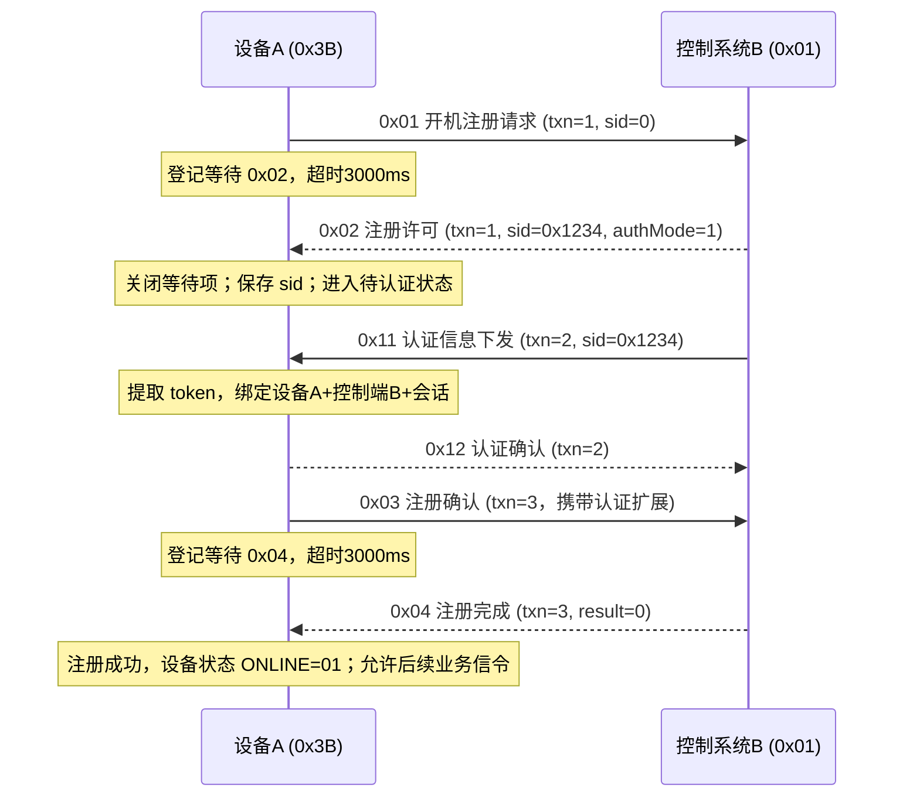

以上事务序号仅为示例。第三步 AUTH_ISSUE 属于 B 主动发起的独立事务；A 处理它的同时，主注册流程可以在“等待认证已就绪”的条件节点上挂起。真实协议如果把 token 直接放在许可报文中，也可以删除 AUTH_ISSUE 子流程，改为提取许可报文字段；主流程无需修改底层 UDP 引擎。

### 注册流程状态（设备级）

`UNREGISTERED → REGISTERING → PERMITTED → AUTH_READY（可选） → CONFIRMING → REGISTERED`。**这是注册流程内部状态序列，不是设备状态枚举**；执行期间设备仍是 OFFLINE，收到合法注册完成后才转 ONLINE。

在 `REGISTERING/PERMITTED/CONFIRMING` 阶段，可通过条件分支进入 `REJECTED / TIMEOUT / FAILED`。认证过期时不直接永久删除设备；将会话标为过期，并由业务流程选择重新认证、重新注册或禁止继续发送。

## 9. 时序二：设备配置与业务控制

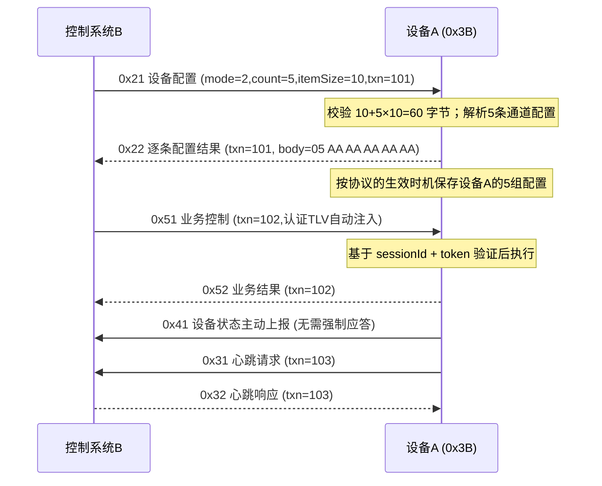

如果 CONFIG_SET 改用 mode=1，则每条 10 字节对应一台设备，结果是新增/更新 5 台设备实例，而不是设备A下的 5 个通道；**两种方式由设备映射规则决定**。

## 9A. 时序三：无人机 A → 无人机 B 视频通话申请（端对端）

**业务前提**：无人机 A=`00 00 3B`、无人机 B=`00 00 3C`，控制系统=`00 00 01`；A/B 均已注册、认证有效。A 申请 TX=`08 00`（2048 kbps）、RX=`02 00`（512 kbps）；B 两个方向相反。控制系统在寻呼成功以后进行资源准入及分配。下列消息与真实协议的先后顺序可以由流程编排器调整。

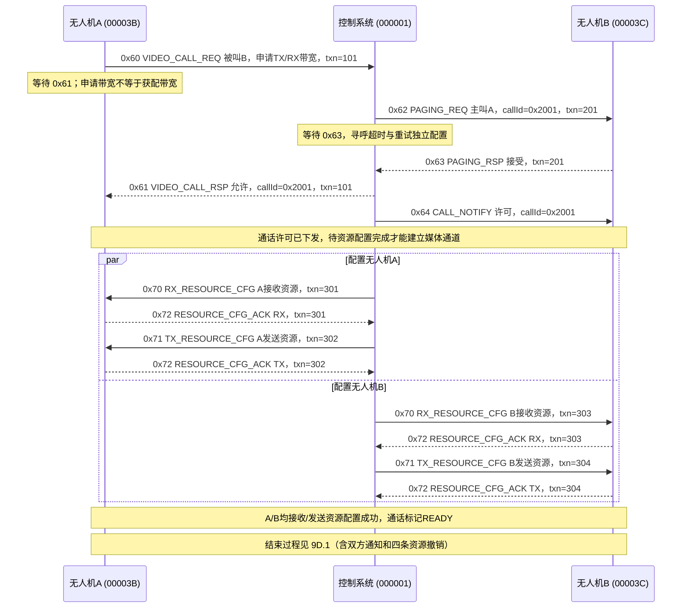

**关键业务状态：** `REQUESTED → PAGING → ACCEPTED_PENDING_RESOURCE → ALLOCATING → READY → ACTIVE（媒体/业务外部触发） → ENDING → RELEASING → ENDED`；资源无法核实时保持 `TERMINATED_CLEANUP_PENDING`，详见第 9D 节。需要注意：MUSP 只是模拟信令与资源参数，不代表此示例已经包含真实音视频媒体流传输。

**失败分支：** 如果 B 拒绝、忙、寻呼超时，则控制系统向 A 回复相应 `0x61` 结果，且不得进入有效资源分配。资源不足可返回失败结果。若配置已部分生效但剩余配置失败，必须释放已分配资源或执行补偿流程，不能让 A 成功而 B 未就绪却宣称端到端通话成功。

**请求关联：** A 最初 `0x60` 的请求保持等待 `0x61`，即使其间控制系统与 B 执行独立的 `0x62/0x63` 寻呼事务；`callId` 用于把寻呼、资源配置及释放关联到同一次通话。`callId` 与公共头中的 `sessionId`（注册会话）不是同一个概念。

## 9B. 时序四：无人机 A → 控制系统语音对话申请（单端）

无人机 A 向控制系统申请语音通话，申请 TX=`00 40`（64 kbps）、RX=`00 40`（64 kbps）。此场景无 B 设备，不执行寻呼，但**控制系统仍需分别下发接收资源和发送资源两条独立信令**。

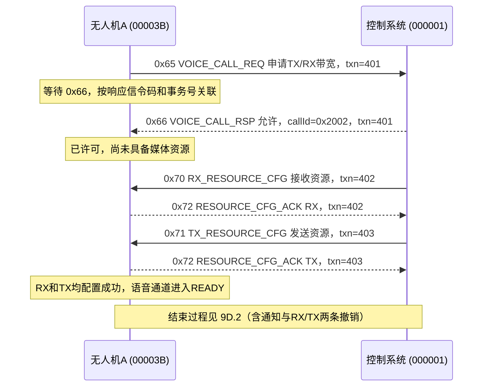

**特殊处理：** 若控制系统拒绝申请，则返回失败 `0x66`，无须下发资源；如果成功响应后某一方向资源配置失败，执行超时重试或回收补偿，流程进入资源失败分支。若此类单端对话在真实业务中只有单方向媒体，仍可以由场景把不需要的资源方向声明为 N/A；当前示例按双向语音完整申请、完整分配。

## 9C. 带宽管理、资源映射与等待项

| 序号 | 业务对象 | 示例 | 约束 |
|---:|---|---|---|
| 1 | 申请带宽 | `requestTxKbps` / `requestRxKbps` | 由申请方填写；A 视频请求 2048/512 kbps；与控制系统最终分配结果分离 |
| 2 | 通话标识 | `callId=20 01` | 由控制系统分配；关联 A、B、寻呼及所有资源 |
| 3 | 资源配置接收方向 | `0x70` | 目标设备本地 RX；独立发送、确认、重试、状态 |
| 4 | 资源配置发送方向 | `0x71` | 目标设备本地 TX；独立发送、确认、重试、状态 |
| 5 | 资源确认 | `0x72` | 对 `0x70` 或 `0x71` 分别确认；借助 txn、设备和方向唯一关联 |
| 6 | 获配带宽 | `assignedTxKbps` / `assignedRxKbps` | 以资源配置信令实际下发值为准，不能从申请值假定成功分配 |
| 7 | 资源生效状态 | `RESERVED / CONFIGURING / APPLIED / ACTIVE / RELEASING / RELEASED / UNKNOWN` | 同一 callId 下按设备、方向独立维护 |
| 8 | 通话就绪门槛 | `A.RX && A.TX && B.RX && B.TX` | 端对端默认需四项；单端默认为 `A.RX && A.TX` |

**发送/接收的方向以无人机自身为参照**。例如 A 申请发 2048 kbps、收 512 kbps；对应 B 的接收 2048 kbps、发送 512 kbps。实际分配要检查资源池容量、频点/时隙冲突、业务优先级和可用带宽，示例不默认申请一定获批。

同一 `0x72` 应答码可以对应多条并发 `0x70/0x71` 请求。等待索引键不能只用 `msgCode=0x72`，必须补充发往设备的目标逻辑身份、应答方源地址、`transactionId`、`callId`、`resourceId` 和 `direction`。对于完全无法区分的旧协议，则应限制同一匹配键并发数。

**请求超时与业务超时两层分开：** 视频申请等待 `0x61`，控制系统在这段时间会寻呼 B，因此 `0x61` 的等待时长应覆盖寻呼与资源准入决策；独立的 `0x62` 等待 `0x63` 有自己的期限；资源 `0x70/0x71` 各自等待 `0x72`。不能用单个 3 秒超时套全部阶段。

**资源生效和释放的幂等性：** 相同设备、callId、方向、资源版本重复下发时应识别重传；回收按 callId+resourceId 定位并保留记录，防止重复释放造成计数错误。重发消息不应产生额外的带宽占用。

## 9D. 通话启动、结束通信与资源回收完整流程（v0.4）

### 9D.1 端对端视频：A 发起结束，控制系统通知 B，逐条撤销四项资源

假设 A=`00 00 3B`、B=`00 00 3C`、控制系统=`00 00 01`、`callId=20 01`，两端均已分配 RX+TX。事件次序如下：

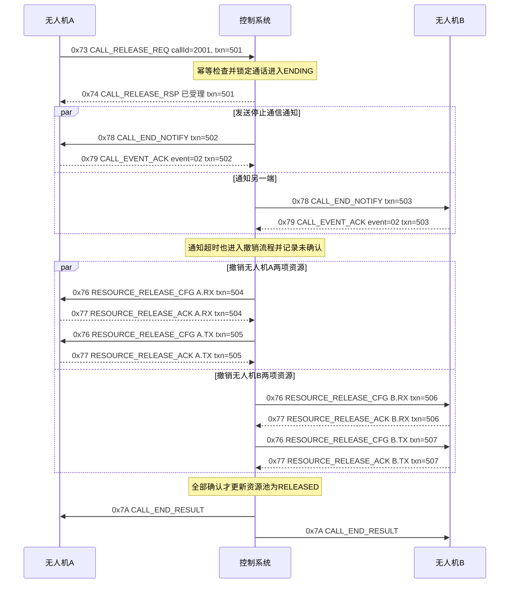

- 当 A 挂断，控制系统需通知 A 和 B；当 B 挂断，主叫/被叫角色互换，但处理规则不变。
- 当控制系统主动结束（管理员停止、业务超时、资源抢占）时，无须等待 `0x73`，直接创建内部结束事件并发送 `0x78`，后续释放流程相同。
- `0x74=00` 仅说明结束申请被受理；`0x7A=00` 必须建立在全部应释放资源确认成功且无待核实项的条件下。
- 若设备已离线无法回复 `0x77`，**不将该资源自动标记 RELEASED**；通话业务可判定已终止，但资源仍为 UNKNOWN，进入后续核对/重试/人工处置。

### 9D.1A 无人机 B 主动结束视频通话（与 A 对称）

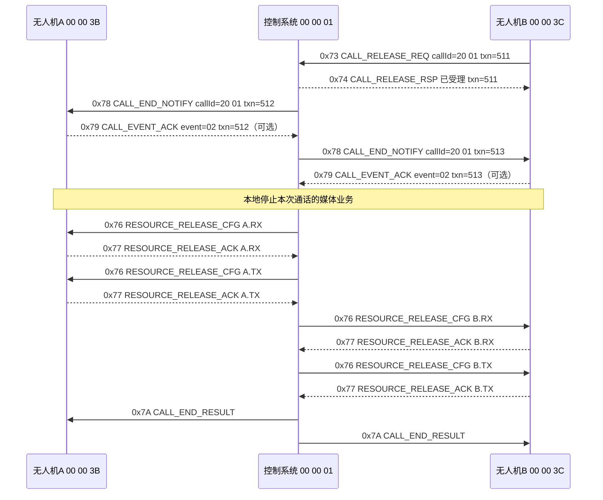

该流程复用“结束一条通话”的通用子流程，只替换发起设备。`0x74` 是受理结果；`0x7A` 才汇总实际资源回收情况。收到 `0x78` 终止且本设备不再有其他成功建立的通话后，设备状态从 `COMMUNICATING(02)` 更新为 `ONLINE(01)`，即使有资源处于回收中或 UNKNOWN 也不额外增加设备状态。

### 9D.1B 控制系统主动结束视频通话

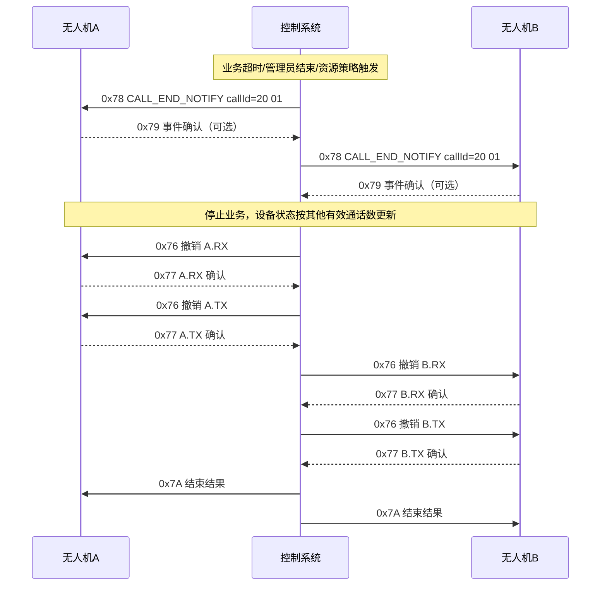

此模式**没有**终端的 `0x73`，因此**不得虚构** `0x74` 响应；控制系统内部直接创建结束事件。资源撤销可以并行执行，上图仅为易读的串行示例。对离线参与者不等待不可能收到的 ACK；记录 UNKNOWN 并继续处理其余在线方。

### 9D.2 单端语音：A 发起结束，独立撤销两项资源

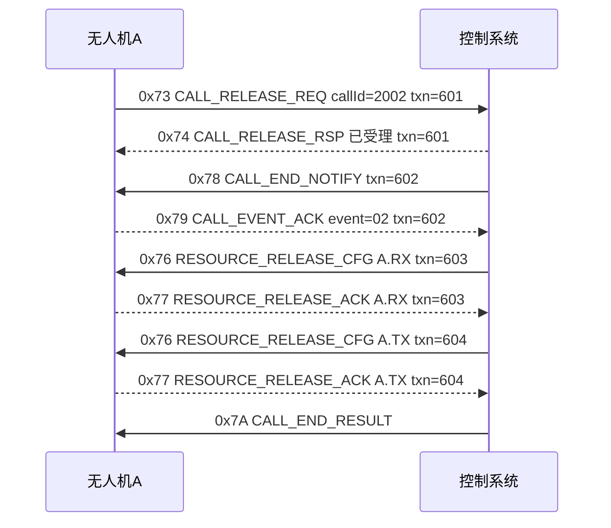

单端语音不需要寻呼 B，也不需要向不存在的 B 发送撤销。此通话如果被配置为纯单向媒体，只有实际生效过的方向需要撤销。

### 9D.3 通话启动方式由协议场景参数决定

| 序号 | 模式 | 配置值 | 生效条件 | 说明 |
|---:|---|---|---|---|
| 1 | 本机资源就绪启动 | `01`（LOCAL_READY） | 每台设备自己的必要 RX/TX 已确认 | 设备可以启用本机业务；整体通话的全局 READY 仍由控制端核对全部参与设备 |
| 2 | 控制系统统一通知启动 | `02`（CONTROL_NOTIFY） | 全部参与设备必要资源已确认、控制端发送 `0x75` | 收到匹配的通知后再允许本机启用；通知 ACK 可配置 |

**注意**：`LOCAL_READY` 允许本机进入 LOCAL_ACTIVE，不等于远端已经可接收；要区分设备局部就绪和通话整体就绪。禁止将协议选择 C 误解为同一通话必须同时完成两种模式。

### 9D.4 通话与资源状态机

通话实例维护 `callState`：

`REQUESTED → (PAGING) → PERMITTED → ALLOCATING → READY → ACTIVE → ENDING → RELEASING → ENDED`

并允许旁路 `REJECTED / CANCELLED / FAILED / TERMINATED_CLEANUP_PENDING`。实际使用中 `READY` 和 `ACTIVE` 之间的启用条件根据启动模式配置。`TERMINATED_CLEANUP_PENDING` 表示通话业务已停止但尚有未知资源，不能展示为资源已全部释放。

每个资源实例独立维护 `resourceState`：

`RESERVED → CONFIGURING → APPLIED → ACTIVE → RELEASING → RELEASED`

异常分支：`FAILED / UNKNOWN`。资源实例以 `(systemId, callId, deviceId, resourceId, direction, resourceVersion)` 唯一定位；实际作用域还应包含本轮运行或分配纪元，防止重复使用 callId 导致迟到报文错配。

**设备注册状态与通话状态分离**：结束 `callId=20 01` 不删除设备 `00 00 3B`，不清除设备注册会话 ID 或认证 Token，也不影响该设备的其他通话（例如 `callId=20 02`）。

### 9D.5 终止处理策略与失败分支

| 序号 | 触发情况 | 立即处理 | 资源处理与结果 |
|---:|---|---|---|
| 1 | A/B 正常挂断 | 接受 `0x73`，响应 `0x74`，通知双方 `0x78` | 四项资源逐一撤销，全部确认后 `0x7A=00` |
| 2 | 控制系统主动结束 | 直接执行结束子流程，通知所有参与者 | 撤销必要资源，无须伪造 `0x73` |
| 3 | 设备心跳失联 | 将受影响通话置为异常终止，其他在线端先收到 `0x78` | 离线端资源变 UNKNOWN，需恢复核对，不得虚假释放 |
| 4 | 一条资源撤销失败 | 保留该资源及失败原因，继续处理其他无冲突资源 | 通话进入 CLEANUP_PENDING；结果 `0x7A=01/03` |
| 5 | `0x76` 已下发但没有 `0x77` | 按信令独立重试，不重复扣减资源 | 超限为 UNKNOWN，`0x7A=02` |
| 6 | 重复 `0x73` 或 `0x76` | 基于 callId / resourceId / 版本实现幂等 | 返回当前处理状态，不重复释放 |
| 7 | 通话正在建立，还没有 callId | 主叫使用 `0x7B` 及原申请事务号取消 | 控制端撤销寻呼及内部已预留资源，回复 `0x7C` |
| 8 | 两端同时发起结束 | 以通话锁/原子状态迁移合并为一次结束流程 | 分别对两端回应请求，统一执行一轮撤销 |
| 9 | 同设备还有其他通话 | 只定位当前 callId 的配置 | 其他 callId 的资源和状态不变 |

### 9D.6 资源池回收与账务一致性

1. 区分 **申请带宽** `requestTx/Rx`、**预留带宽** `reserved...`、**实际分配带宽** `assigned...` 和 **已确认释放带宽** `released...`。
2. 通话许可、资源配置发送和通话业务停止均不自动增加资源池剩余容量。
3. `0x77=00` 且版本、资源 ID、设备地址、方向正确时，才按资源池模型执行一次释放核销。对端状态尚不明确时不将 UNKNOWN 容量重新分配。
4. 同一个 callId 下资源可能归属多个独立频点、时隙、TX/RX 池，不简单将所有 kbps 相加得到链路可用容量。
5. 确认资源不存在、设备重新启动、系统重启后的回收，要走**状态核对/资源重建**策略，而不是仅凭 ACK 超时强制判定已释放；支持人工确认并保留审计记录。
6. `callId` 仅 2B，必须定义作用域和复用保护窗口，在旧事务全部关闭、迟到包窗口结束后才允许复用相同编号。

### 9D.7 请求/响应等待队列中的新增匹配关系

| 序号 | 请求信令 | 等待响应 | 默认匹配字段 | 示例等待超时 |
|---:|---|---|---|---|
| 1 | `0x73` 结束申请 | `0x74` 已受理 | msgCode、transactionId、发起设备、callId | 2000 ms |
| 2 | `0x75` 启用通知 | `0x79` 启用确认（可选） | msgCode、transactionId、callId、eventType=`01`、设备 | 2000 ms |
| 3 | `0x78` 终止通知 | `0x79` 终止确认（可选） | msgCode、transactionId、callId、eventType=`02`、设备 | 2000 ms |
| 4 | `0x76` RX/TX 资源撤销 | `0x77` 资源撤销确认 | msgCode、transactionId、callId、resourceId、direction、版本、设备 | 2000 ms |
| 5 | `0x7B` 呼叫取消 | `0x7C` 取消应答 | msgCode、transactionId、原申请事务、设备 | 2000 ms |

以上超时值仅是**测试默认值**，每个等待节点都应支持单独配置。重试时默认复用同一事务序号，对相同命令幂等；协议可以覆写。超时调度要与响应处理互斥，迟到 ACK 不得使已经释放或失败的其他资源二次扣减或二次回收。

### 9D.8 对模拟平台的额外要求

- **流程子图复用**：把“结束通信 + 通知 + 分向撤销 + 结果汇总”做成可复用子流程；视频有 A/B 四个资源实例，语音只有 A 两个实例，框架不需要写两套释放引擎。
- **动态循环节点**：从 `call.participants` 和 `call.resources` 生成每设备/每方向的释放任务，而不是给 A、B 写死四个节点。
- **并行与汇合**：不同设备可并行撤销，同设备的 RX/TX 是否并行由协议策略配置；所有必需项汇合后才能计算最终结果。
- **设备视图**：记录设备参加的多条通话、每条通话的资源 ID、版本、方向、申请/分配/已释放带宽。
- **异常可追溯**：留存原始报文 HEX、等待项、超时重试、资源变更、每条 ACK、结束结果以及未确认项；支持重放和人工核对。
- **可配置协议差异**：并不是所有真实协议都需要 `0x75/0x78/0x7A` 等额外信令，允许在流程模板中省略或替换，不把这些信令写成引擎固定逻辑。

## 9E. 设备三态、主动离线、心跳失联及恢复（v0.6 修订）

### 9E.1 设备状态：仅三个枚举值

| 序号 | 设备状态 | HEX | 触发事件 | 处理规则 |
|---:|---|---|---|---|
| 1 | `OFFLINE` 离线 | `00` | 新设备创建、主动离线 `0x7D`、心跳失联达到门限 | 禁止发起新通话；已关联通话执行终止与回收；不删设备配置 |
| 2 | `ONLINE` 在线 | `01` | 完成注册 `0x04`；结束最后一条已成功建立的通话且仍保持注册有效 | 可以发起通话；不因为单纯配置修改而改变 |
| 3 | `COMMUNICATING` 通信 | `02` | 根据对应协议的启动策略，至少一条通话已成功建立 | 本机仍有其他已建立通话时，结束一条不能降为 ONLINE |

设备配置或修改与设备上线无必然关系：**仅新增设备实例默认为 OFFLINE**，更新已注册设备参数不能强制将状态置离线。注册申请/寻呼/资源配置中的 `WAITING、ALLOCATING、TIMEOUT、CLEANUP_PENDING` 都是**流程运行状态**，并非设备状态；设备状态不会增加第四个值。

设备状态优先级：明确离线/判定掉线 `OFFLINE` > 本机已建立通话数大于零 `COMMUNICATING` > 注册成功且未离线 `ONLINE`。主动离线后允许保留仅用于资源清理的受限通信窗口，这不改变其 `OFFLINE` 状态。

`0x41 STATUS_REPORT` 的 deviceState 字段同样仅接受 `00/01/02`；其字段属于上报值，不能在未通过场景校验的情况下直接覆盖平台设备的权威状态。

### 9E.2 正常主动离线：无活跃通话

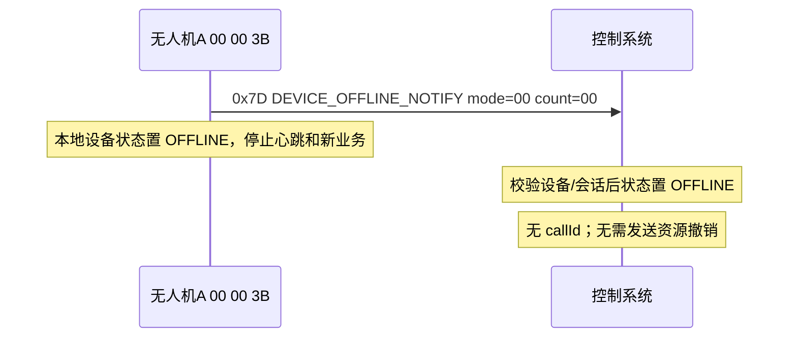

`0x7D` 是默认无强制应答的单向事件，不生成不存在的请求响应等待项。UDP 发送成功并不意味着控制系统一定收到通知；控制侧没有收到时，可在自己的心跳监测规则满足后将设备判为 OFFLINE。保留设备实例与静态配置，旧会话标记为不可用于新业务。

### 9E.3 主动离线：仍与 B 视频通信，保留清理窗口（offlineMode=01）

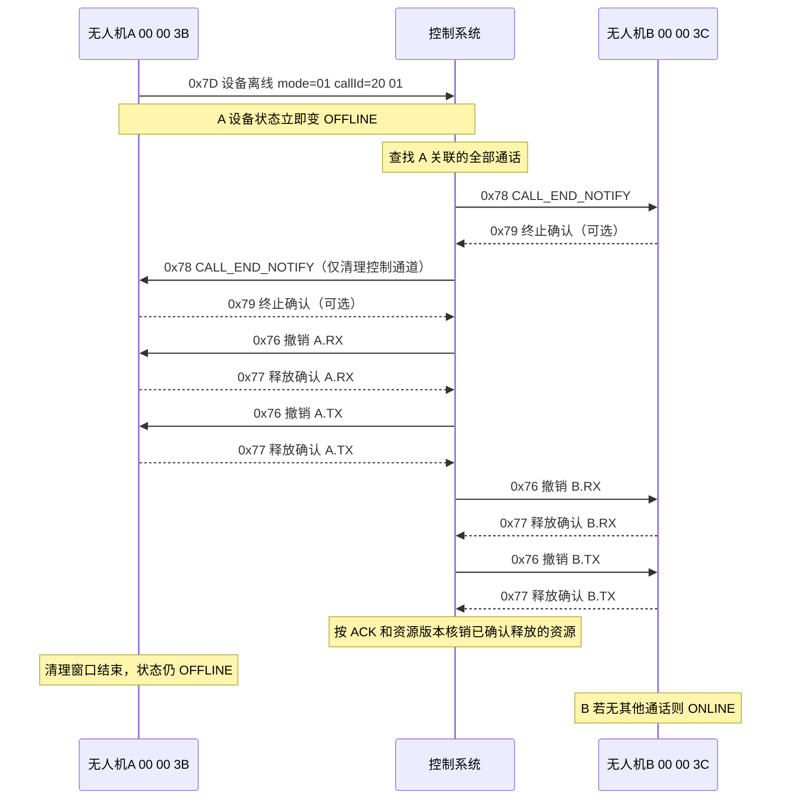

- `offlineMode=01` 的意义是**尝试在离线后短暂保持清理控制通道**，不是 OFFLINING 设备状态。仅允许完成指定的终止/撤销信令，不允许新通话、配置申请、原会话业务继续执行。
- 设备本地发送 `0x7D` 时立即转 OFFLINE；控制系统在收到有效 `0x7D` 时转 OFFLINE。两侧状态传播存在 UDP 延时，需记录事件时间。
- 清理通道超时后关闭，不得永远等待；无法得到 A 的 `0x77` 时，其对应资源进入 UNKNOWN。清理结果通过通话实例、资源实例记录，不增加设备状态。

### 9E.4 立即主动离线（offlineMode=00）与异常掉线

| 序号 | 来源 | 是否收到 `0x7D` | 设备显示状态 | 资源处理 |
|---:|---|---|---|---|
| 1 | A 主动立即离线 | 是（假设有效送达） | `OFFLINE (00)` | 终止关联通话、通知 B；A 端不可达资源为 UNKNOWN；B 的 RX/TX 正常撤销确认后核销 |
| 2 | A 异常断电 / 网络中断 | 否 | 监测门限达成后 `OFFLINE (00)` | 不伪造离线信令；终止相关通话，B 正常清理，A 资源 UNKNOWN |
| 3 | A 心跳短暂丢包但未达离线门限 | 否 | 保持原 `ONLINE (01)` 或 `COMMUNICATING (02)` | 仅流程内部累计监测计数，不改变设备状态 |

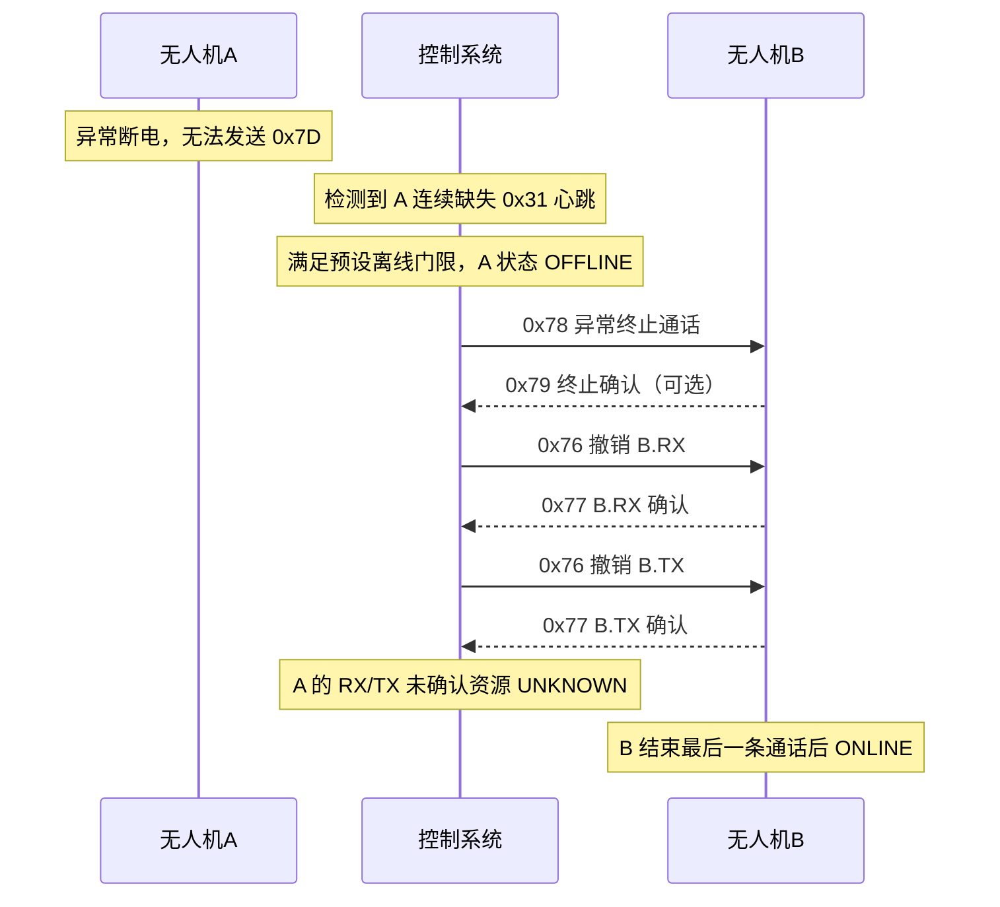

这里 MUSP 使用设备发 `0x31` 心跳请求、控制系统回复 `0x32`，所以控制系统根据**未收到设备心跳请求**判定失联；门限为协议场景的监测策略，不新增“疑似离线”的设备状态。

### 9E.5 正常通信结束后设备如何恢复状态

| 序号 | 事件 | A 的已建立通话 | B 的已建立通话 | A 状态 | B 状态 |
|---:|---|---|---|---|---|
| 1 | A/B 已注册但未通话 | 0 | 0 | `ONLINE (01)` | `ONLINE (01)` |
| 2 | A/B 一条视频通信成功 | 1 | 1 | `COMMUNICATING (02)` | `COMMUNICATING (02)` |
| 3 | A 又建立一条单端语音 | 2 | 1 | `COMMUNICATING (02)` | `COMMUNICATING (02)` |
| 4 | A/B 视频正常终止 | 1 | 0 | `COMMUNICATING (02)` | `ONLINE (01)` |
| 5 | A 最后一条语音正常终止 | 0 | 0 | `ONLINE (01)` | `ONLINE (01)` |
| 6 | A 突然掉线 | 0（全部强制终止） | 0（收到终止事件） | `OFFLINE (00)` | `ONLINE (01)` |

通话数计算应使用当前设备参加且已建立、尚未业务终止的通话集合，不按 UDP 消息数量加减。`0x74=00` 只是结束申请**已受理**，不能单凭它认定业务已经停止。通常在 `0x78` 被有效执行或协议定义的等效终止事件生效后，将对应通话从“正在通信集合”中移除；资源清理可能继续进行。

### 9E.6 控制系统主动结束与两端同时发起结束

- 控制系统主动结束：**不需要 `0x73/0x74`**，直接向可达参与方下发 `0x78`；按照 `call.participants[].resources[]` 逐项下发 `0x76` 并等待 `0x77`，最后汇总 `0x7A`。
- B 主动结束：与 A 相同，只是 `0x73` 的发起者换成 B；不得只支持主叫挂断。
- A、B 同时结束同一通话：两条独立 `0x73` 都可以得到自己的 `0x74`；控制系统对同一 `(callId, 运行纪元)` **只创建一个结束子流程**，不重复释放四条资源。
- 一台设备多条通话：只清理指定 `callId` 对应的资源；离线事件则枚举该设备相关**全部**通话和进行中的申请。另一台参与方其他无关通话不能被清理。
- 通话未被许可或尚未分配 `callId` 就取消：使用 `0x7B/0x7C`，按原申请事务号关联，不错误发送针对不存在 callId 的 `0x73`。

### 9E.7 UDP 等待队列和异常状态处理

| 序号 | 触发/发送信令 | 期望应答 | 核心匹配字段 | 超时分支 |
|---:|---|---|---|---|
| 1 | `0x73` 结束一条通话 | `0x74` | 信令码、txn、设备地址、callId、会话及对端 | 允许按幂等键重试；不得重复创建释放流程 |
| 2 | `0x78` 终止通知 | 可选 `0x79` | 信令码、txn、设备地址、callId、eventType=`02` | 重试/记未确认；仍按策略继续资源撤销 |
| 3 | `0x76` RX 资源撤销 | `0x77` | 信令码、txn、设备、callId、resourceId、direction=`01`、resourceVersion | 独立重试；超限该资源 UNKNOWN |
| 4 | `0x76` TX 资源撤销 | `0x77` | 信令码、txn、设备、callId、resourceId、direction=`02`、resourceVersion | 独立重试；超限该资源 UNKNOWN |
| 5 | `0x7D` 主动离线 | 无强制应答 | 按报文事件路由到设备离线子流程 | 不建立无效等待项，控制侧由心跳监测兜底 |

- 每条需要应答的请求**先登记等待项再发送**。超时/响应在一次状态迁移中原子仲裁，迟到 ACK 不能让已经结束的另一轮 callId 获得资源。
- 对 `0x76/0x77`，必须核对资源版本、方向、设备及事务号，`0x77` 成功后仅核销一次；未确认回收的容量不重新进入资源池。
- 离线导致通话业务强制停止，不等于资源全部 RELEASED；平台保留通话内部 `CLEANUP_PENDING` 或资源 `UNKNOWN`，但**设备状态只有三态**。
- 离线后重新注册成功才可恢复 `ONLINE`；不得仅因一个旧心跳或迟到响应自动上线。新会话应使旧 token 与旧事务失效；对未确认资源执行独立的核对流程。

### 9E.8 设备配置后的状态约束

无论手工创建新设备，还是通过 `0x21` 配置报文新增实例，初始 `deviceState=00 (OFFLINE)`；再次接收配置更新既有设备时保持其当前状态，不强制离线。通信状态由设备正在参与的已建立通话决定，不将配置生效误判为“在线”或“通信”。

## 10. 请求-响应等待项设计（重点）

### 10.1 概念

发送需要响应的信令时，先创建 `PendingRequest`（逻辑等待队列元素），再发送 UDP 包。收到报文时先解码并按**信令码**筛选等待项，再按设备、事务和通信对端进一步筛选，命中一个合法等待项后恢复对应流程。

```text
PendingRequest {
    runId              // 当前场景运行实例
    flowInstanceId      // 当前流程运行实例
    sendNodeId          // 发送节点
    protocolId          // 所属协议和版本
    localEndpointId     // 本地UDP监听/发送端点
    remoteEndpointId    // 目标网络端点或对端匹配规则
    deviceInstanceId    // 当前业务设备实例
    requestMsgCode      // 例如0x01
    expectedResponseCodes = [0x02]
    transactionId       // 例如1
    matchSrcAddr        // 期望响应的源逻辑地址，0x01
    matchDstAddr        // 期望响应的目标逻辑地址，0x3B
    sessionMatchRule    // 初始注册允许从0变为分配的会话ID
    deadline            // 超时时间
    retryPolicy         // 重试次数、间隔、是否复用事务号
    attemptCount        // 已发送次数
    status              // WAITING/MATCHED/TIMED_OUT/CANCELLED
}
```

### 10.2 建议匹配顺序

1. 首先匹配监听端点及协议识别规则，完成公共头解析、总长和 CRC 校验。
2. 使用 `msgCode` 查找 `expectedResponseCodes` 包含该信令的未完成等待项。
3. 进一步匹配逻辑源/目的设备地址、事务序号 `transactionId`、场景/协议、配置的远端 IP:port 规则。
4. 已建立会话的流程通常同时匹配 `sessionId`，但**注册许可允许由 0 转换成分配的新会话 ID**，不能机械地按相等判断。
5. 如果合法唯一匹配，原子地将 WAITING 改为 MATCHED、取消超时、解析业务体、输出流程变量、沿成功/拒绝分支继续。
6. 如果没有匹配项，将其交给主动上报/异步事件处理器，或进入“未匹配报文”；若多个等待项都可匹配，应视为匹配规则冲突，而非随机选择一个。

### 10.3 两条并发注册请求

| 序号 | 当前等待实例 | 来源设备 | 已发送信令 | 等待响应码 | transactionId |
|---:|---|---|---|---|---|
| 1 | flow-A | `0x3B` | `0x01` | `0x02` | `0x00000001` |
| 2 | flow-C | `0x3C` | `0x01` | `0x02` | `0x00000002` |

到达报文 `msgCode=0x02, dstAddr=0x3B, transactionId=1` 时，**只唤醒 flow-A**。信令码确定响应类型，并不能独自保证多设备并发时的唯一关联。

如果接入的外部 UDP 协议**没有**事务序号，仍可按设备/对端/状态进行匹配；但在报文没有任何可区分信息的情况下，应限制同一匹配键下的并发等待实例数量，不能声称仅靠队列就能准确对应。

### 10.4 超时策略（示例）

- 等待 0x02：每次 3000 ms，最多重试 3 次，间隔 1000 ms；最终失败走 `REGISTER_TIMEOUT`。
- 等待 0x04：每次 3000 ms，最多重试 3 次；最终失败走 `REGISTER_CONFIRM_TIMEOUT`。
- 等待 0x22：每次 2000 ms，最多重试 2 次；**重发可能重复更改设备配置，必须搭配事务号和幂等处理**。
- 所有时间及策略均属于流程节点配置，可独立覆盖；这里“最多重试 3 次”指**首次发送以外最多再发 3 次**。
- 重试时默认保持 `transactionId` 不变，便于对端去重；外部协议若规定每次重试换号，可以显式配置。
- 超时后的迟到包不应重新激活已经失败的流程；必须在日志中保留“迟到响应”及其关联事务信息。
- 等待队列建议是事件式逻辑队列（待响应注册表+时间调度器），不要求一条请求占一个阻塞线程。
- **发送前登记 PendingRequest**，避免极快响应到达而尚无匹配项。

### 10.5 等待项生命周期

`CREATED → WAITING → MATCHED → RESUMED → CLOSED`，异常分支可转入 `RETRYING / TIMED_OUT / CANCELLED`。多包应答、同一请求多个允许的响应码、主动下发消息都可以通过明确的匹配规则和独立触发器扩展。

## 11. 流程模板示例（结构化 DSL 伪配置）

> 是为了表达配置模型，不规定未来一定使用 YAML 或此 DSL 语法。

```yaml
flowId: register-device
participants: [deviceA, controlB]
trigger:
  type: manual-or-device-start
  binding: deviceA
variables:
  deviceAddr: "${device.address('MUSP')}"
steps:
  - id: send-register
    type: sendAndWait
    sender: deviceA
    receiver: controlB
    request: REGISTER_REQ
    expectCodes: [0x02]
    match: [protocol, endpoint, deviceAddr, transactionId]
    timeoutMs: 3000
    maxRetries: 3
    onSuccess: check-license
    onTimeout: register-timeout
  - id: check-license
    type: condition
    expression: "${response.resultCode} == 0"
    true: save-session
    false: register-rejected
  - id: save-session
    type: assign
    outputs:
      session.id: "${response.header.sessionId}"
      session.authMode: "${response.authMode}"
    next: maybe-auth
  - id: maybe-auth
    type: condition
    expression: "${session.authMode} == 1"
    true: wait-auth-ready
    false: send-confirm
  - id: wait-auth-ready
    type: awaitEvent
    event: "session.authReady"
    timeoutMs: 3000
    next: send-confirm
  - id: send-confirm
    type: sendAndWait
    sender: deviceA
    receiver: controlB
    request: REGISTER_CONFIRM
    expectCodes: [0x04]
    match: [protocol, endpoint, deviceAddr, transactionId, sessionId]
    timeoutMs: 3000
    maxRetries: 3
    next: check-complete
  - id: check-complete
    type: condition
    expression: "${response.resultCode} == 0"
    true: set-registered
    false: register-rejected
  - id: set-registered
    type: setDeviceState
    state: REGISTERED
```

认证子流程 `onMessage(0x11)`：校验来源控制端与 sessionId → 提取 `AUTH_ISSUE.token` → 存入 `session.authToken` 与失效时间 → 回复 `0x12`（回填事务号）→ 发布 `session.authReady` 事件。该事件与 `wait-auth-ready` 之间需要“状态条件 + 事件订阅”原子化检查，避免认证信息先到、后注册监听而丢失唤醒。

## 12. 运行时变量与设备绑定

| 序号 | 作用域 | 引用例子 | 生存期 / 约束 |
|---:|---|---|---|
| 1 | 系统 | `system.controlCenter.endpoint` | 系统配置 |
| 2 | 设备 | `device.address('MUSP')`、`device.config.channels[0]` | 设备实例；配置需记录版本 |
| 3 | 会话 | `session.id`、`session.authToken`、`session.authExpiresAt` | 同一设备+对端+会话的独立上下文 |
| 4 | 流程 | `flow.currentTxnId`、`flow.response` | 单次流程执行 |
| 5 | 步骤 | `step.input`、`step.parsedResult` | 当前步骤；显式输出可提升作用域 |

认证注入示例：`MUSP 业务类信令（例如0x51、0x41）` 根据协议规则决定是否要求 `session.authToken`。认证字段编码位置为 `type=0xA1` 的扩展 TLV；`flags.bit0=1`。没有 Token 或 Token 过期时，不生成业务报文，走 `REAUTH_REQUIRED` 分支。是否对心跳携带认证同样由协议策略决定；样例心跳默认不要求。

设备 ID 是系统内部稳定唯一标识，`0x3B` 是 **MUSP 协议中的地址**；同一设备在另一套协议中的地址可以不同。选中设备时，要通过协议身份查找地址，并根据报文角色将其绑定到 `srcAddr` 或 `dstAddr`，不能无条件写同一字段。

## 13. 可核算十六进制示例（与 v0.3 字节结构一致）

### 13.1 注册请求（35 字节）

`msgCode=01`，基础头 23B + 业务体 10B + CRC 2B = 35B（`00 23`）；CRC-16/CCITT-FALSE：`8073`。

```text
AA 55 01 17 00 23 01 00 00 3B 00 00 01 00 00 00
00 00 01 00 00 00 0A 01 00 00 00 3B 01 00 03 00
01 80 73
```

### 13.2 注册许可响应（32 字节）

`msgCode=02`，23B + 7B + 2B = 32B（`00 20`）；`sessionId=12 34`；CRC-16/CCITT-FALSE：`0EA8`。

```text
AA 55 01 17 00 20 02 00 00 01 00 00 3B 02 00 00
00 00 01 12 34 00 07 00 00 00 0E 10 01 00 0E A8
```

### 13.3 单设备五组参数配置（91 字节，未启用 configCommon8 的 v0.7 兼容示例）

`msgCode=21`，扩展头 6B；23B + 6B + 60B + 2B = 91B（`00 5B`）；CRC-16/CCITT-FALSE：`FF22`。

```text
AA 55 01 1D 00 5B 21 00 00 01 00 00 3B 01 00 00
00 00 65 12 34 00 3C A1 04 DE AD BE EF 02 01 05
0A 00 00 3B 00 01 00 01 01 00 0F 42 A4 00 0A 01
00 02 01 00 0F 43 08 00 0A 01 00 03 01 00 0F 43
6C 00 0A 01 00 04 01 00 0F 43 D0 00 0A 01 00 05
01 00 0F 44 34 00 0A 01 00 FF 22
```

### 13.4 端对端视频申请（43 字节）

`msgCode=60`，申请 TX=`08 00`、RX=`02 00`；23B + 6B + 12B + 2B = 43B（`00 2B`）；CRC-16/CCITT-FALSE：`94AF`。

```text
AA 55 01 1D 00 2B 60 00 00 3B 00 00 01 01 00 00
00 00 65 12 34 00 0C A1 04 DE AD BE EF 00 00 3C
02 08 00 02 00 00 03 01 00 94 AF
```

### 13.5 单端语音申请（39 字节）

`msgCode=65`，申请 TX/RX=`00 40`；23B + 6B + 8B + 2B = 39B（`00 27`）；CRC-16/CCITT-FALSE：`DF81`。

```text
AA 55 01 1D 00 27 65 00 00 3B 00 00 01 01 00 00
00 01 91 12 34 00 08 A1 04 DE AD BE EF 01 00 40
00 40 01 01 00 DF 81
```

说明：所有设备地址占 **3 字节**；会话 ID 占 **2 字节**；信令码占 **1 字节**。CRC 已按修改后的完整实际字节重新计算，不能继续使用 v0.2 旧示例 CRC。

### 13.6 设备 A 主动离线通知（28 字节，无在途通话）

- `msgCode=0x7D`；`srcAddr=00 00 3B`、`dstAddr=00 00 01`，`sessionId=12 34`；事务标识 `00 00 00 80` 仅用于追踪/幂等，不意味着强制存在响应。
- `offlineReason=01`（正常关机）、`offlineMode=00`（立即）、`activeCallCount=00`，所以 `bodyLength=00 03`。
- 基础公共头 23B + 业务体 3B + CRC16 2B = **28B**，`totalLength=00 1C`，`headerLength=17`，`flags=00`。
- 按 CRC-16/CCITT-FALSE 计算，尾部 CRC=`2C21`（高字节先行）。

```text
AA 55 01 17 00 1C 7D 00 00 3B 00 00 01 00 00 00 00 00 80 12 34 00 03 01 00 00 2C 21
```

如果仍存在 `callId=20 01`，则业务体可以使用 `01 01 01 20 01`（正常关机、请求清理、1 条通话）；此时业务体 5B，必须重新计算报文长度和 CRC，不得复用上述 28B 示例的校验值。

### 13.7 设备配置逐条成功响应（31 字节）

配置请求 `0x21` 中包含 5 条记录；设备 `00 00 3B` 对控制系统 `00 00 01` 回复 `0x22`。假设请求事务号为 `00 00 00 65`、会话 ID 为 `12 34`，不携带认证扩展头（只为清楚展示此例；实际是否携带扩展头由协议策略决定）。

- `msgCode=22`；`srcAddr=00 00 3B`；`dstAddr=00 00 01`。
- `headerLength=17`（23 字节）、`bodyLength=00 06`（6 字节）、`totalLength=00 1F`（31 字节）。
- 业务体 `05 AA AA AA AA AA`，表示 5 条全部配置成功。
- `flags=02`（响应），`transactionId=00 00 00 65`；CRC-16/CCITT-FALSE 校验尾值为 `FE CB`。

```text
AA 55 01 17 00 1F 22 00 00 3B 00 00 01 02 00
00 00 00 65 12 34 00 06 05 AA AA AA AA AA FE CB
```

注意：业务体中首字节 `05` 是结果条目数，后面的五个 `AA` 依次代表五条配置成功。CRC 已按上述完整示例重新计算，不应沿用旧版响应的示例校验值。

## 14. 必须验证的测试用例

| 编号 | 场景 | 期望结果 |
|---|---|---|
| T01 | 设备 0x3B 正常注册、认证、完成 | 设备 ONLINE(01)；Token 与该会话绑定 |
| T02 | 0x3B / 0x3C 同时注册，响应先后反转 | 分别只唤醒正确等待项 |
| T03 | 收到正确应答码但错误的 transactionId | 不唤醒等待项，记录不匹配 |
| T04 | 注册许可超时 | 按设置重发；超过上限进入超时失败 |
| T05 | 收到重复应答 | 不重复改变状态；记录重复/迟到 |
| T06 | 等待注册许可期间收到心跳/认证下发 | 独立路由，不误唤醒注册等待项 |
| T07 | count=5, itemSize=10 | 解析 50B 数组，不多读或少读 |
| T08 | mode1 的 5 条配置 | 创建/更新 5 个设备实例 |
| T09 | mode2 的 5 条配置 | 更新设备 0x3B 的 5 条通道参数 |
| T10 | itemCount 与 bodyLength 不匹配 | 结构校验失败，不应用配置 |
| T11 | 配置重发、相同事务号 | 幂等处理，避免重复创建 |
| T12 | 认证信息已失效 | 阻止需要认证的业务发送，走重新认证分支 |
| T13 | 跨系统协议共用端口 | 根据协议识别规则正确路由；歧义则报告错误 |
| T14 | 同设备配置变更与业务发送并发 | 符合可配置的一致性快照/版本策略 |
| T15 | 真实系统不携带事务号 | 强制适当关联键串行，不能误匹配并发响应 |
| T16 | 逐条结果存在非 `AA` 项 | 对应条目标记未确认成功；全量替换默认不整体提交，增量按已确认项执行 |
| T17 | A→B 视频通话，寻呼成功 | `0x60 → 0x62 → 0x63 → 0x61/0x64`，呼叫获准但尚未 READY |
| T18 | A→B 视频：A/B 分别配置 RX/TX | 发出 4 个独立的 `0x70/0x71`，各自匹配 `0x72`，全成功才 READY |
| T19 | A→B 视频：B 忙或拒绝 | 控制系统向 A 返回失败 `0x61`，不得把资源标记已分配 |
| T20 | A→B 视频：B 寻呼超时 | `0x62` 超时按寻呼策略处理，最终给 A `0x61` 失败 |
| T21 | 单端语音申请 | `0x65 → 0x66`，随后独立下发 `0x70` 和 `0x71` 给 A |
| T22 | 相同 `0x72` 并发应答 | 用事务号 + callId + resourceId + 方向 + 设备匹配，不串响应 |
| T23 | 申请带宽与分配带宽不同 | 资源最终值读取 `assigned...`，不得覆盖原申请值 |
| T24 | 资源部分失败 | 资源回滚/补偿或标记失败，通话不能进入 READY |
| T25 | 通话结束及重复请求 | `0x73/0x74` 只代表受理；`0x78` 停止、`0x76/0x77` 逐项释放、`0x7A` 汇总；幂等回收 |
| T26 | 本机就绪模式 | 不发 `0x75`；本机可启用，但全局就绪按参与方资源汇总 |
| T27 | 控制系统统一启动 | A/B 四项资源成功后分别下发 `0x75`，按需匹配 `0x79` |
| T28 | A 主动结束 A↔B 视频 | A/B 均收到 `0x78`；分别撤销四条 RX/TX 资源并核销 |
| T29 | B 主动结束 A↔B 视频 | 角色互换，复用相同结束子流程 |
| T30 | 控制系统主动终止视频 | 无需设备 `0x73`，主动通知 A/B 并撤销资源 |
| T31 | 单端语音结束 | 仅对 A 通知终止、撤销 RX/TX 两条资源 |
| T32 | A/B 同时结束同一通话 | 只创建一个结束实例，不重复释放 |
| T33 | 一条 `0x77` 超时 | 该资源 UNKNOWN，通话停用但不可报告全量已释放 |
| T34 | 一条释放确认失败，其余成功 | 进入 TERMINATED_CLEANUP_PENDING，结果非 `00` |
| T35 | 一台设备有两条通话 | 释放 `20 01` 不影响 `20 02` |
| T36 | 尚未获得 callId 的申请被取消 | 以 `0x7B/0x7C` 取消原申请，防止迟到许可重新激活 |
| T37 | `0x78` 和 `0x75` 共用 `0x79` | 按 eventType、txn、callId、设备区分等待项 |
| T38 | 通话结束后设备继续心跳/注册 | 保留设备实例、注册会话及认证信息，不混用状态 |
| T39 | 旧 callId 被复用后迟到应答 | 按复用保护窗口和分配纪元拦截，不能修改新通话 |

| T40 | 已注册设备发送 `0x7D`，无通话 | 状态更新为 OFFLINE；不删除设备、不伪造资源释放，也不要求强制 ACK |
| T41 | 设备 A 正与 B 视频通话，发送 `0x7D` mode=01 | A 立即 OFFLINE，清理流程单独保留临时控制窗口，B 收到终止通知；资源按 ACK 核对；A 状态不改变 |
| T42 | A 正与 B 视频通话，发送 `0x7D` mode=00 | 通知 B 并回收其资源；A 无法确认的资源 UNKNOWN，不作为可分配容量 |
| T43 | 设备 A 异常断电，未发送 `0x7D` | 心跳达到离线判定门限后直接更新 OFFLINE；触发异常通话收尾，期间不新增设备状态 |
| T44 | 设备 A 同时有视频与语音两条通话 | 离线枚举并分别结束全部相关 callId；不影响 B 的其他独立通话 |
| T45 | 重复 `0x7D` 或离线后迟到 `0x72/0x77` | 离线处理幂等；旧会话报文不能误改变新状态或二次回收 |
| T46 | `0x7D` 报文业务体计数与长度不一致 | 解析失败，不触发离线状态变更，保留 HEX 和错误日志 |
| T47 | OFFLINE 后仍收到旧会话心跳 | 不自动恢复在线；按规定重新注册或新会话确认后才恢复 |

## 15. 由这份协议倒推出的平台必备模块

1. **系统管理**：系统定义、协议绑定、逻辑参与者、网络端点。
2. **协议设计器**：公共头、变量长度扩展、信令字典、信令请求/应答关系、结构体、动态数组、字段约束、字节序、校验函数。
3. **设备管理**：设备类型、内部设备 ID、各协议地址、网络配置、手工配置与报文映射配置、配置版本和历史。
4. **交互流程设计器**：发送并等待、单独监听、条件、事件、循环、并行、定时、变量赋值、设备配置应用、子流程和异常出口。
5. **运行引擎**：场景实例、流程状态、待响应队列/索引、时间轮或超时调度、重试、幂等、事件驱动路由。
6. **会话管理**：会话 ID、认证资料、作用域和失效机制、自动字段注入。
7. **UDP 通信层**：统一端口接收、协议识别、报文路由、发送及网络记录，支持多个模拟参与者和外部对端。
8. **诊断与回放**：按流程/设备/事务查看原始 Hex、解析字段、匹配原因、超时、重试、配置变更和变量演变。
9. **通话管理**：callId、参与者、两种启动策略、本机/全局就绪、结束/取消子流程、多通话隔离。
10. **资源管理与回收**：每设备 RX/TX 资源分项、配额/预留/占用、逐条撤销、未知状态、资源池核销与异常补偿。
11. **设备在线状态与离线模拟**：设备主动离线报文 `0x7D`、仅三态设备状态、心跳离线判定、跨通话终止、离线重注册和旧会话隔离。

## 16. 后续需要用真实业务校正的问题

1. 设备地址在 MUSP 中固定为 3 字节，其他协议是否允许自定义长度，是否每条消息都有源/目标地址？
2. 注册许可究竟携带 sessionId/Token，还是通过独立认证下发，注册完成通知属于应答还是独立事件？
3. 报文序号由哪个方向生成？应答是否原样回填？如果实际没有序号，哪些字段可以区分多台设备的同类请求？
4. 配置报文中哪些条目代表设备实例，哪些条目仅代表设备参数？全量配置还是增量配置？
5. 设备配置何时生效：收到请求、发出应答、接到最终确认，还是等待业务状态满足条件？
6. 控制系统是否会不经请求而主动发起配置、控制、认证更新？
7. 业务信令是否全部需要认证信息？字段是在公共头、业务头，还是业务体内？
8. 本地模拟设备对 UDP IP:port 的映射，是每设备独立端口还是多设备共享端点？

> **本版 v0.5 沿用的业务约束**：信令码 1B，会话 ID 2B，设备地址字段 3B；申请报文填写带宽，接收/发送资源分别使用独立信令下发；两种通话均可追溯通话实例与资源实例；通话启动机制支持 LOCAL_READY / CONTROL_NOTIFY 两种策略；通话结束需通知参与方并单独核对 RX/TX 资源回收。

> **v0.6 最终讨论约束**：设备只有 `OFFLINE(00) / ONLINE(01) / COMMUNICATING(02)`；`0x7D` 为主动离线单向信令；异常失联不伪造离线报文；注册、资源回收、异常监测各自作为流程/资源内部状态；离线引起的通信必须收尾，但 UNKNOWN 资源不得自动计入可用容量。

> **推荐下一轮讨论顺序**：确认通话停止事件的最终生效点、挂断通知 ACK 是否为必需、各类资源回收失败的核对方法、心跳周期与离线门限；再据此设计流程引擎和设备状态展示。

## 17. v0.6 补充测试用例（设备三态及结束闭环）

| 编号 | 场景 | 期望结果 |
|---|---|---|
| T48 | 人工配置新设备 | 默认 OFFLINE(00)，不自动上线 |
| T49 | `0x21` 创建新设备 / 修改已在线设备 | 新实例 OFFLINE(00)；修改已有设备不改变当前在线状态 |
| T50 | A 与 B 视频建立成功 | 两者均 COMMUNICATING(02) |
| T51 | B 通过 `0x73` 正常结束视频 | 控制系统通知 A/B；仅在本设备没有其他已建立通话时恢复 ONLINE(01) |
| T52 | 控制系统主动发 `0x78` 终止视频 | 无伪造 `0x73/0x74`，A/B 正确退出通信，分别撤销资源 |
| T53 | A 同时参加视频与语音，结束视频 | A 仍 COMMUNICATING(02)，B 无其他通话时 ONLINE(01) |
| T54 | A 发 `0x7D` mode=01 正在通信 | A 立即 OFFLINE(00)，可保留受限清理控制窗口，其他业务禁止执行 |
| T55 | A 心跳连续丢失但未达离线门限 | A 仍保持原 01/02 状态，不创建 SUSPECT 设备状态 |
| T56 | A 突然掉线且 B 仍在线 | A OFFLINE(00)，通知 B 终止；A 未确认资源 UNKNOWN，B 资源正常释放 |
| T57 | `0x76` 已发送但 `0x77` 丢失 | 资源 UNKNOWN，不回收容量，晚到 ACK 不越过事务生命周期 |
| T58 | A、B 同时发送 `0x73` | 分别返回受理，控制系统仅执行一次结束/资源撤销子流程 |
| T59 | A 离线后收到旧会话心跳或旧 0x77 | 不自动变 ONLINE，也不重复核销资源 |
| T60 | 已结束最后一条通话，但还有资源 UNKNOWN | 注册有效则设备 ONLINE(01)，资源保留 UNKNOWN 并独立核对 |

## 18. v0.7 补充测试用例（配置逐条响应）

| 编号 | 场景 | 期望结果 |
|---|---|---|
| T61 | 请求 5 条，响应 `05 AA AA AA AA AA` | 按原请求顺序认定 5 条全部成功；成功数量由数组推导 |
| T62 | 请求 5 条，响应声明 `05` 但只跟 4 个结果字节 | 业务体长度不合法，不视为成功响应 |
| T63 | 请求 5 条，响应返回 4 条完整结果 | 数量不一致，不能错位应用条目结果 |
| T64 | 请求 5 条，响应中的某一项不是 `AA` | 保留该项原始结果 HEX，标记该项未确认成功；不杜撰失败码含义 |
| T65 | 请求 5 条，响应重复到达 | 使用事务号与设备/会话匹配，重复应答不重复生效 |
| T66 | 请求 5 条，等待 `0x22` 超时 | 标记结果未知并执行配置的超时策略，不直接认定远端配置失败 |
| T67 | 相同 `0x22` 对应不同设备请求并发 | 依事务号、设备地址、会话正确匹配，不串条目结果 |
| T68 | mode=01 多设备配置与 mode=02 单设备多参数配置 | 两者均使用“数量+逐项结果”响应；由请求的模式及条目顺序完成结果映射 |


## 18. v0.8 全信令解析引擎规范（同时适用于协议设计器与运行日志）

### 18.1 功能定位：一份协议定义，两种用途

- **编辑/发送**：用户按中文语义编辑字段值，编码器生成 HEX 报文、自动长度、校验字段和必要的自动填充值。
- **接收/解析**：对相同协议模板的任何信令，按公共头 → 可选扩展 → 配置公共段（按模板） → 专用业务结构 → CRC 的次序逐层拆解，展示**实际字节位置、HEX、十进制、二进制、中文字段名及解释**。
- 文档中的**协议字段定义表不显示偏移**；只有解码器的**报文分析结果**显示实际位置，这是两个不同的视图，不相互冲突。

### 18.2 建议的协议字段元数据

每条字段建议维护（不是在协议表里增加列）：

| 序号 | 配置属性 | 描述 |
|---:|---|---|
| 1 | `key / labelZh` | 英文引用名和中文字段名 |
| 2 | `byteLength / countExpr` | 固定字节长或动态计算表达式，例如 `itemCount × itemSize` |
| 3 | `wireFormat` | 报文原始形式依然是 HEX；可根据配置区分整数字段、原始字节数组、ASCII/BCD 等 |
| 4 | `byteOrder / signed` | 大端、小端；有符号/无符号；符号位解释不能混淆 |
| 5 | `enumMap / bitFields` | 原值 → 中文枚举；Bit7..Bit0 / 连续位段各自中文解释 |
| 6 | `scale / unit` | 例如 `0x0040 = 64 kbps`；缩放单位只影响业务显示、不改变 HEX 原值 |
| 7 | `children / elementSchema` | 嵌套结构、结构体、重复数组及其子字段 |
| 8 | `condition / selectSchema` | 条件存在、根据 configMode 选择不同 item 结构 |
| 9 | `validation / defaultValue` | 固定值、长度、范围、保留位、CRC、字节序及业务有效性校验 |
| 10 | `sourceBinding` | 固定值、手动输入、设备参数、会话变量、流程变量、计算表达式 |

建议位域定义示意（用于协议配置、不是实际 UDP 报文）：

```yaml
protocol: MUSP
message: '0x21'
sections:
  - schema: baseHeader23
  - schema: authTLV
    when: header.flags.bit0 == 1
  - schema: configCommon8
    enabled: true
    length: 8
    fields:
      - key: configFlags
        labelZh: 配置控制标志
        byteLength: 1
        displayType: HEX
        bitFields:
          - {name: atomic, labelZh: 原子性, bitStart: 7, bitWidth: 1}
          - {name: end, labelZh: 结束标识, bitStart: 0, bitWidth: 1}
      - {key: batchId, labelZh: 配置批次编号（待确认）, byteLength: 2}
      - {key: segmentNo, labelZh: 分段序号（待确认）, byteLength: 2}
      - {key: reserved, labelZh: 预留字节, byteLength: 3}
  - schema: configSetBody
    fields:
      - {key: configMode, byteLength: 1, enumMap: {'01': 多设备, '02': 单设备多参数}}
      - {key: operation, byteLength: 1}
      - {key: itemCount, byteLength: 1}
      - {key: itemSize, byteLength: 1}
      - {key: targetDeviceAddr, byteLength: 3}
      - {key: configVersion, byteLength: 2}
      - {key: reserved, byteLength: 1}
      - key: items
        repeat: itemCount
        elementLength: itemSize
        selectElementSchemaBy: configMode
```

以上表达式仅为“模板语义示意”，将来可转换为 JSON Schema / 内部 DSL，但运行时不能对不可信报文执行任意脚本；条件和长度计算应使用受限、可校验的表达式。

### 18.3 实时解析输出结构

每条报文在界面上包含两套同时可查看的内容：

1. **原始 HEX 视图**：16 字节每行，左侧十六进制行号，点击任意字节高亮对应字段与树节点；支持复制带空格 HEX、复制连续 HEX。
2. **字段树 + 表格视图**：按公共头、扩展头、配置公共段、专用业务体、CRC 分组；字段树展开数组的 `items[0]...items[N-1]`，位字段展开 `Bit7...Bit0`；表格支持中英文名、值、单位、中文枚举、解释和错误告警。

**字段解析结果列**（不是协议定义表）：

| 序号 | 数据列 | 说明 |
|---:|---|---|
| 1 | 序号 | 对应当前树节点或表格的显示序号 |
| 2 | 字节位置 | 以 1 开始的实际包内起止字节，如 `30`、`42–44`；界面可选显示从 0 开始的偏移 |
| 3 | 字段名 | 中文名 + 可展开的英文属性标识 |
| 4 | 长度 | 字节数；位子字段显示 `1 bit` 或范围 |
| 5 | HEX | 例如 `00 00 3B` |
| 6 | 十进制 | 对数值字段以正确有符号性和字节序换算；对 raw bytes 可以不显示单一十进制数 |
| 7 | BIN / 位值 | 普通字段可折叠，位域必显，如 `1000 0001` |
| 8 | 中文含义 | 如 `AA → 配置成功`、`02 → 单设备多参数` |
| 9 | 业务解释/单位 | 如 64 kbps、频率 Hz、设备关联名称或未定义状态 |
| 10 | 校验结果 | 正常、长度不符、未知枚举、保留位非零、CRC 错误等 |

**数值解释规则**：例如两个字节 `FF FE`，如果协议定义为无符号大端整数，十进制是 `65534`；若定义为有符号 16 位补码，十进制是 `-2`。编码约束（带宽单位/频率单位/BCD 等）不应仅凭 HEX 字符串猜测。对于 Token 等敏感字段，默认遮盖其 HEX/BIN/DEC 和复制内容，只有具备调试授权时可显式查看。

### 18.4 Bit 解析规则

以配置控制字节 `81` 为例：

- 8 位二进制：`1000 0001`；整体无符号 DEC：`129`。
- `atomic = (0x81 >> 7) & 0x01 = 1`，中文：**原子配置要求开启**。
- `end = 0x81 & 0x01 = 1`，中文：**本批最后一段**。
- `reserved = (0x81 >> 1) & 0x3F = 0`，中文：**保留位为零**。
- bit 编号在同一字节内以最低有效位 Bit0 开始；字节编号与 bit 编号属于不同的定位方式。对于跨字节位段，由协议显式定义字节序和位序，不能直接套用本例。
- 修改一个 bit 时仅改变该 bit：设置 Bit7 用掩码 `0x80`；设置 Bit0 用掩码 `0x01`；其他 6 位原值必须保留（除非模板明确要求清零）。

### 18.5 99B 配置请求样例（含认证扩展与 8B 通用段，已核算）

本例保留 v0.7 `0x21` 单设备 5 组通道配置，将新的 8B 通用段插入在认证扩展之后、原有 10B 专用配置前缀之前。字段值：控制端 `00 00 01` → 无人机 A `00 00 3B`；事务号 `00 00 00 65`；会话 `12 34`；认证 TLV `A1 04 DE AD BE EF`；配置标志 `81`；`batchId=00 01`、`segmentNo=00 01`；模式 `02`、操作 `01`，配置 5 组，每组 `0A` 字节。

总长：`headerLength = 23+6 = 29B = 1D`；`bodyLength = 8+10+5×10 = 68B = 00 44`；`totalLength = 29+68+2 = 99B = 00 63`。

```text
AA 55 01 1D 00 63 21 00 00 01 00 00 3B 01 00 00
00 00 65 12 34 00 44 A1 04 DE AD BE EF 81 00 01
00 01 00 00 00 02 01 05 0A 00 00 3B 00 01 00 01
01 00 0F 42 A4 00 0A 01 00 02 01 00 0F 43 08 00
0A 01 00 03 01 00 0F 43 6C 00 0A 01 00 04 01 00
0F 43 D0 00 0A 01 00 05 01 00 0F 44 34 00 0A 01
00 EB 46
```

CRC-16/CCITT-FALSE：`EB 46`，计算覆盖最后 CRC 前的 97 字节。

**解码器示例输出**（包内位置从第 1 字节计数，不是协议定义表的偏移列）：

| 字节位置 | 字段（中文） | HEX | DEC / 位值 | 中文解析 |
|---|---|---|---|---|
| 1–2 | 同步头 | `AA 55` | — | 固定同步标识 |
| 3 | 协议版本 | `01` | 1 | 版本 1 |
| 4 | 公共头长度 | `1D` | 29 | 23B 基础头 + 6B 认证扩展 |
| 5–6 | 报文总长 | `00 63` | 99 | 共 99 字节 |
| 7 | 信令码 | `21` | 33 | 设备配置请求 CONFIG_SET |
| 8–10 | 源设备地址 | `00 00 01` | 1 | 控制系统 |
| 11–13 | 目标设备地址 | `00 00 3B` | 59 | 无人机 A |
| 14 | 头部标志 | `01` | 1 | 带认证扩展 |
| 16–19 | 事务序号 | `00 00 00 65` | 101 | 配置请求事务 |
| 20–21 | 会话 ID | `12 34` | 4660 | 当前会话（与通话 callId 不同） |
| 22–23 | 业务体长度 | `00 44` | 68 | 含 8B 配置通用段、10B 专用配置前缀和 50B 数组 |
| 24–29 | 认证扩展 | `A1 04 DE AD BE EF` | — | 类型 `A1`、Token 4B，界面默认脱敏 |
| 30 | 配置控制标志 | `81` | 129 / `1000 0001` | Bit7 原子性=1，Bit0 结束=1，其余位=0 |
| 31–32 | 配置批次编号（待确认） | `00 01` | 1 | 批次 1 |
| 33–34 | 分段序号（待确认） | `00 01` | 1 | 第 1 段 |
| 35–37 | 通用预留字节 | `00 00 00` | — | 当前仅原样保留 |
| 38 | 配置模式 | `02` | 2 | 单设备多参数 |
| 39 | 操作类型 | `01` | 1 | 全量替换 |
| 40 | 配置条目数 | `05` | 5 | 动态数组有 5 项 |
| 41 | 单条长度 | `0A` | 10 | 每项 10 字节 |
| 42–44 | 目标配置设备地址 | `00 00 3B` | 59 | 无人机 A |
| 45–46 | 配置版本 | `00 01` | 1 | 配置版本 1 |
| 47 | 专用配置预留字节 | `00` | 0 | 固定 0 |
| 48–57 | 配置条目 items[0] | `01 01 00 0F 42 A4 00 0A 01 00` | — | 第 1 组通道配置，展开可定位子字段 |
| 58–97 | 配置条目 items[1..4] | 共 40B | — | 其余 4 组，每组 10B，独立展开 |
| 98–99 | CRC16 | `EB 46` | — | CRC 校验通过 |

**第 1 条记录继续展开**：`items[0].channelId` 位于字节 48，HEX `01` → DEC 1；`configType` 字节 49 为 `01`；`centerFreqHz` 位于字节 50–53，HEX `00 0F 42 A4` → DEC `1000100 Hz`；`powerLevel` 字节 54–55 为 `00 0A` → DEC `10`；`enabled` 字节 56 为 `01` → 中文“启用”；保留字节 57 为 `00`。

### 18.6 CONFIG_RESULT 逐条响应的解析示例（沿用 v0.7）

依旧使用下方业务体，不强制携带配置通用 8B：

```text
05 AA AA AA AA AA
```

| 字节位置（相对业务体） | 字段名 | HEX | DEC | 中文含义 |
|---|---|---|---|---|
| 1 | 配置条目数 | `05` | 5 | 共有 5 条配置结果 |
| 2 | 第 1 条结果 | `AA` | 170 | 配置成功 |
| 3 | 第 2 条结果 | `AA` | 170 | 配置成功 |
| 4 | 第 3 条结果 | `AA` | 170 | 配置成功 |
| 5 | 第 4 条结果 | `AA` | 170 | 配置成功 |
| 6 | 第 5 条结果 | `AA` | 170 | 配置成功 |

对完整 31B 响应报文，业务体实际位置是第 24–29 字节，CRC 在 30–31 字节。**位置根据报文头实际长度动态换算**；不得在规则里写死“第 24 字节一定是响应条目数”，因为带认证扩展、带配置公共段或未来扩展都能改变位置。

`AA` 是目前唯一已确认的成功结果，其余值在中文含义列显示“未定义结果码（原始 HEX）”，不自行推断失败原因。逐条结果仍按请求项原顺序关联，并遵守匹配事务 ID/设备/会话的要求。

### 18.7 34 种已定义信令的统一解析覆盖

`0x01/02/03/04` 开机注册；`0x11/12` 认证；`0x21/22` 设备配置；`0x31/32` 心跳；`0x41` 状态上报；`0x51/52` 通用业务；`0x60–66` 视频/语音/寻呼；`0x70–7D` 收发资源、通信建立/结束/离线。这 34 条信令均应使用**公共头 Schema + 信令码路由专用 Schema + 按需插入公共段**，而不是单独写 34 个硬编码解析器。

每个信令模板都需要支持：中文字段树、数值转换、字段枚举映射、可选 Bit 拆分、整包 HEX 定位、校验结果、源/目标设备关联；对于通道数组、设备配置数组则递归展开对应条目。不存在数据定义的字段只能原样标成“未知字段”，不能凭经验猜中文含义。

### 18.8 解析引擎内部流水线（只作技术方案，不限制实现语言）

```text
UDP 原始字节
  -> 协议识别（监听端点 + magic + version + 可配置规则）
  -> 解析公共头（检查 headLength / totalLength / bodyLength / CRC）
  -> 解析可选公共头扩展（认证 TLV）
  -> 根据信令码选择信令 Schema
  -> 按模板选择是否解码 configCommon8 等复用结构
  -> 递归解析专用业务体：固定字段、条件字段、位域、数组、结构体
  -> 生成统一字段节点树（每个节点保留 byteStart/byteEnd、原始字节、解码值）
  -> 使用 enumMap/scale/unit/设备索引增加中文解释
  -> 输出 HEX 表、字段树、BIN/DEC 与完整校验信息
  -> 解码成功后，按事务码/设备/会话路由交互流程与等待项
```

建议**解析结果对象**只描述事实，不立即修改设备配置或状态。设备变更需要通过流程执行器依据确认结果和配置生效策略单独提交。协议已识别但结构无效的报文应保留原 HEX、错误位置和原因；不得进入正常业务配置生效流程。

### 18.9 边界与错误处理

1. `headerLength < 23`、`bodyLength` 不匹配、UDP 实长与 `totalLength` 不符、CRC 错误：完整报文校验失败，保留原文、突出错误字节。
2. 配置公共段启用但剩余业务体不足 8B：提示“配置通用段长度不足”，不要继续读后续数组。
3. `configFlags.Bit6..Bit1` 非零：本示例显示“保留位非零”；是否拒绝由协议模板约束，不应全平台硬编码拒绝。
4. `itemCount * itemSize` 超过剩余字节或平台保护阈值：拒绝正常解析并保留 HEX，防止超长/恶意数组。
5. `end=1` 但前置配置分段未到齐：标记批次未完整，不因结束标识而直接提交。
6. 原子性 `atomic=1`、逐条响应出现非 `AA` 或部分响应超时：批次结果不能宣称原子成功；真实对端可能已经部分生效，按 UNKNOWN/状态核对策略处理。
7. `0x22` 条目数与关联请求不一致：不能将结果数组按错误下标应用到设备记录。
8. `0x21` 选择模式 `01/02` 后，必须使用对应 10B 子结构；子字段合计必须等于 `itemSize`。
9. 多协议共用端口、相同信令码跨系统：通过协议实例及版本分派；不能只凭 `0x21` 选择默认的 MUSP 结构。
10. 对不能转换为整数的字段（原始 Token、保留字节、任意二进制块）十进制列显示 `—` 或字节数组，不进行虚假的十进制解释。
11. Bit 编辑须使用掩码保留其他位；字段修改后联动更新报文长度、CRC、HEX 高亮以及所有动态字节范围。

### 18.10 应增加的协议验证用例

| 编号 | 场景 | 期望结果 |
|---|---|---|
| T60 | 不启用 configCommon8，解析 v0.7 91B 配置请求 | 保持兼容，解码 5×10B 配置 |
| T61 | 启用 configCommon8，解析 v0.8 99B 配置请求 | bodyLength=68、totalLength=99、CRC=`EB 46` |
| T62 | flags=`00/01/80/81` | 独立识别 atomic 与 end 的四种组合 |
| T63 | Bit6..Bit1 为非零 | 按配置警告或拒绝，解析 HEX 原值仍可见 |
| T64 | 配置通用段仅收到 7B | 报告长度不足，不越界、不修改设备 |
| T65 | 5 条结果 `05 AA AA AA AA AA` | 展开 5 条，每条 HEX=AA、DEC=170、含义=配置成功 |
| T66 | 条目结果中出现非 AA | 保留未知结果码原值，不捏造错误说明 |
| T67 | Bit7=1、结束标识 Bit0=0，后续还有分段 | 维持配置批次待完成状态 |
| T68 | 结束标识 Bit0=1 但缺分段 | 显示批次不完整，不能提交整批成功 |
| T69 | 有符号 `FF FE` 字段与无符号 `FF FE` 字段 | 按 Schema 分别显示 -2 和 65534 |
| T70 | 动态数组 `itemCount=05, itemSize=0A` | 展开 5 个条目并显示实际字节位置 |
| T71 | 认证扩展改变头长 | 正确迁移业务段位置，不使用固定偏移 |
| T72 | 用户修改配置控制位 | 保留其他位，重新编码并更新 CRC |

### 18.11 待用户用实际协议进一步校正

1. 8 字节的真实名称和字段安排是什么？目前**只有 Bit7 原子性、Bit0 结束**来自已提出的业务要求；其余字节的批次、分段定义是建议。
2. `atomic=1` 要求整批全部成功才生效，还是仅表明“本次配置不可拆分”？是否有实际的提交/回滚步骤？
3. `end=1` 是结束一批**配置分段**，还是结束本次**设备配置任务**？目前选前者作为演示。
4. `0x22` 配置响应也包含 8B 通用段吗？当前**默认不包含**，维持 `05 AA...`。
5. 保留位非零是否报错，是否存在定义的其他标志位？
6. 十进制显示是否需要对地址或频率采用特殊编码、倍率或单位？需要以具体协议为准。

